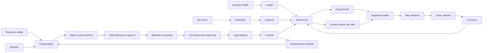

# War sim architecture

Status, 2026-10-15. The tick is one day. Built and tested: closed continent for goods, a plant draws only from a connected node on its own continent, frozen research, cited African nameplates, contact then one shot, splash, the shared mount cap in `_fight`, leader-signed retool, a seated general sets land posture, the naval fight in `sim/systems/naval.py`, the march step in `sim/campaign/step.py`, a ground step that would enter sea is refused, optical night cut 8/24 applied once, year-state load when `scenario.yaml` lists the path, and an event log for a shot, a death, a plant gate, and a surrender. Not built: a measured cell grid, coast cells, air combat in section 17, pocket yield, and the rest of section 12. A scale is not a coast. A loaded catalog is not a calibration. A `sink_milli` raid is still a script. The `cas` writer is retired. `continent_stocks` is not a plant input. Night stays 8/24 until a latitude lookup exists. A head of state does not set a land posture. `scenarios/europe_africa` has no cells, no ships, no leader rows, and no general rows. It is not a prediction.
Date: 2026-10-14
Scope: simulation core, data model, supply chain, and the map contract. Not a port of Command: Modern Operations. Same visible behaviors, independent design.

Example scenario (data, not a special case): 1939 Europe vs modern Africa. That war is two year-states, section 18. The first run is Europe in 1939 alone, to calibrate the engine. The later run reuses that same year-state against a cited modern Africa year-state. Both load through the same schemas. Asymmetry is stocks, sensors, parts, resource nodes, and industrial recipes. There is no era branch in combat code. The campaign clock is not the civil year.

## 1. System diagram



The diagram is the target shape. The live driver is `step_day` in `sim/campaign/step.py`. `sim/systems/schedule.py` does not call it. `sim/orders/channel.py` appends to a `World`. The day step does not read that log.

Data flow, one tick:

1. Clock advances one day. Compression runs N days per wall step. `year = day / 360`.
2. One day is one pass of `step_day`. There is no second loop inside the day. The live order is listed below. Section 10 changes what movement reads. It does not add a clock.
3. Every system is due every day. A bubble predicate still decides who is resolved in detail. It does not decide whether the day happens.
4. Systems read and write components. Iteration order is entity id, ascending.
5. Combat reads the unit buffer written by the last logistics pass. It does not read the mine, the factory, or the national stockpile.
6. Detection writes the contact picture. It does not move hostile icons by leaking ground truth.
7. A destroyed mount or an empty crew billet enqueues replacement demand. Demand is not a free respawn.
8. Snapshot builder emits a renderer DTO for the viewing side.
9. Renderer draws. It may drop frames. It may not invent entities.
10. Player, script, or future AI appends orders. C2 delivers them after comms latency.

The renderer never holds fuel, ammo, or hit points. If the snapshot and the world disagree, the world wins.

## 2. Decisions

### ECS, including formations

Every simulated thing is an entity: platform, section, ship, gun, depot, factory, resource node, convoy, formation, installation.

A formation is not a special object tree. It is an entity with `Identity`, `Organization`, and `Composition`. Children point at it with `parent_id`. Shared components (position, side, supply buffer) and unique ones (a factory has `Industry`, a tank has `WeaponMount`, a mine has `ResourceNode`) stay independent. Inheritance fails the moment a port is both a target and a production site.

### Authoritative sim, dumb renderer

`World` is the only mutable sim state. The map subscribes to snapshots and submits orders. Time compression changes the clock, not which entities the renderer is allowed to create.

### Daily tick

Base quantum: 1 day. A year is 360 days. A month is 30 days.

| System | Cadence | Resolution |
|---|---|---|
| Detection, combat, point defense | 1 day | Detailed only inside a contact bubble. One engagement per pair, not 86,400 shots. |
| Movement inside a bubble | 1 day | Integer millimeters. Distance is one day's march. |
| Movement outside a bubble | 1 day | One step on the 10 km grid. |
| Logistics, allocation, transit arrival | 1 day | Always. |
| Production, training, victory check | 1 day | Always. |

The bubble set for day D is frozen before any system runs that day. Both sides promote on the same day. Skipped detail is not a hidden second clock. Night is a fraction of the day (8/24) applied once to optical shots. The clock does not step hours.

Live order inside `step_day`, after the guard that returns if victory is already set:

1. Construction, frozen research, power, line efficiency.
2. Mine, then refine. Refiner output credits `continent_stocks[continent]`.
3. Movement. `_move` reads an accepted course. No course, no move. The cell map is not read.
4. Detection, then one engagement per contact made that day if the target is inside weapon range.
5. Age lots, then produce. A plant draws only its own continent's stock.
6. Resolve the shots. Integrity at 0 sets `alive` false. Then recount victory points.
7. Air, raids, capture, same-continent dispatch, imports, hubs, fuel stat, quiet attrition, order counters, food burn.
8. Increment the day. Surrender check. Year snapshot if `day % 360 == 0`.

Pause, step, and compress change days only. The two older orders in this file (production then detection, and detection then movement) are retired. Do not restore them.

Bubble membership is frozen for the tick. An entity is in the set if any of these hold against a Track whose quality is `detected` or better:

- Its position is within `R` of that track. `R` is the producing sensor's modified range in millimeters, floored at `min_bubble_m` (default 10 km) and capped at `max_bubble_m` (default 80 km).
- Its id equals the track's `target_id`.
- Its id equals the track's `observer_id`.

The union is sorted by entity id. No system may add or remove members until the next tick. Disaggregation of an aggregated parent in that set runs after the freeze and before detection, and the new child ids are appended in slot order.

Bubble membership is still frozen for the day before that pass. A rack refilled today is visible to today's combat only if production ran before the shot, which it does. C2 delivery of a course is section 10. It is not in this pass.

### Deterministic core

- Entity scans are sorted by id. No hash-map order.
- Positions in the sim are integers (millimeters, millidegrees). Floats exist only in the renderer.
- Randomness is a named stream: `combat`, `detection`, `c2`, `production`. Seed is `scenario_seed + tick + stream_name`. Rolls are logged.
- Wall-clock time is not an input.
- The only nondeterministic systems are those that take a stream. Weather fronts, if stochastic, use `weather` and are marked. A replay feeds the same orders and seed and must hash-match.

### Spatial partition and aggregation

Strategic index: 10 km cells. Fine index: 250 m cells, built only inside bubbles. Pair tests happen inside a cell and its neighbors, not across the theater.

Aggregation is sim state.

- `aggregated`: children are rows in `Composition`, not ticking entities. Group speed is the slowest march speed. Logistics are summed. Detection uses the best sensor. Signature is the sum of member signatures.
- `disaggregated`: children are real entities. The formation still exists as the parent.

Promotion into a contact bubble emits `Disaggregate` before tactical systems run. IDs of children are `parent_id + slot`. The renderer does not spawn them. Leaving contact can re-aggregate only when no member is engaged and the composition still matches. That fold is also a sim event.

### No era switch

Combat reads numbers: penetration, armor, accuracy, seeker kit, crew skill, weather, dud rate. A 1939 optical gun and a GPS bomb are two catalog rows. The side with no seeker kits fires the bomb body unguided because the kit quantity is 0, not because a rule says modern wins. `tech_level` is not an input to the hit product. Missing parts select a degraded row. They do not multiply damage by year.

### Cargo identity

A ton is not a ton of ammunition. Chrome, fuel, explosives, fuzes, and seeker kits keep their cargo id from the resource node through the path to the depot. The depot converts kilograms of a cargo id into rounds only when a recipe or a packing rule says those kilograms are that ammo id. A Sahara delivery of chrome does not become shells.

## 3. Component schemas

Catalog ids are strings. Stats live in catalogs. Entities hold counts, current state, and references.

### Identity

```yaml
Identity:
  id: string
  name: string
  side: string
  unit_type: string          # catalog id
  echelon: individual|section|platoon|company|battalion|regiment|brigade|division|installation
```

### Organization

```yaml
Organization:
  formation_id: string|null
  parent_id: string|null
  experience: int            # 0-100
  morale: int                # 0-100
  fatigue: int               # 0-100
  training: int              # 0-100
  aggregated: bool
  supply_priority: int       # higher is served first; ties break by entity id
```

### Composition

Present on formations and on aggregated parents.

```yaml
Composition:
  slots:
    - slot: int
      unit_type: string
      count: int
      ammo: {ammo_id: int}   # summed while aggregated, by ammo id
      fuel_l: int
      integrity_mean: int
```

### Physical

```yaml
Physical:
  mass_kg: int
  length_mm: int
  width_mm: int
  height_mm: int
  armor:
    - aspect: front|side|rear|top|bottom
      thickness_mm: int
      material: none|wood|aluminum|rha|composite
      ke_mod: int            # thousandths, 1000 = nominal
      heat_mod: int
  integrity: int             # structure pool
  integrity_max: int
  mobility_hp: int
  firepower_hp: int
  signature:
    visual: int
    ir: int
    radar_m2_milli: int
    acoustic: int
  posture: exposed|hull_down|dug_in|embarked
```

### Mobility

```yaml
Mobility:
  speed_mmps:                 # millimeters per second, by context key
    road: int
    offroad: int
    sea_calm: int
    sea_rough: int
    alt_low: int
    alt_high: int
  fuel_l: int
  fuel_max_l: int
  burn_ml_per_km: int
  range_m: int
  amphibious: bool
  lift: none|road|rail|sealift|airlift
  domain: ground|sea|air|static
  fuel_grade: avgas|mogas|diesel|bunker|coal|none
```

Speed lookup is `domain × terrain class × weather band` from a table. Missing keys mean the unit cannot enter that cell. An aircraft with `fuel_l` below the sortie cost does not enter a bubble. The airframe still exists.

### Sensors

```yaml
Sensor:
  kind: optical|ir|radar|sonar|esm
  range_m: int
  accuracy: int               # 0-1000
  generation: int             # catalog number, not a code switch
  weather_mod: {clear: int, rain: int, night: int, rough_sea: int}
  terrain_mod: {open: int, forest: int, urban: int}
  requires_item: string|null  # fire-control or set id; missing item uses the degraded row
```

An entity may have many `Sensor` components. Detection takes the best applicable sensor after modifiers. ESM detects emitters. It does not grant a perfect track. A missing `requires_item` uses `accuracy_degraded` and may cut range. It does not delete the sensor.

### Weapons

```yaml
WeaponMount:
  mount_id: string
  kind: gun|rocket|missile|bomb|torpedo|depth_charge
  caliber_mm: int
  domain: ground|sea|air
  rof_per_min: int
  reload_s: int
  barrel_life: int            # rounds before the worn-barrel row applies
  rounds_fired: int
  accepts: [string]           # ammo ids this mount may fire
  ready: {lot_id: int}        # rack holds lots, not anonymous counts
  hardpoints:
    - station_id: string
      accepts: [string]
      mass_cap_kg: int
      incompatible_with: [string]
  payload_cap_kg: int         # fuel mass and weapon mass share this
  range_bands:
    - max_m: int
      accuracy: int
      accuracy_degraded: int  # no sight, no fire control, or worn barrel
      min_range_m: int
      tof_s: int              # time of flight at max_m; point defense uses this
      penetration_mm: int     # default only; ammo penetration wins if set
      blast: int
      blast_radius_m: int
```

Multiple mounts per entity. A shot is legal only if the ammo id is in `accepts` and every part and kit in that ammo row has quantity above 0 in `ready`. No legal row means `no_ammo`. The selector must not fall through to an incompatible id.

`guidance` is not a field on the mount. It lives on the ammo row or on the seeker kit. The platform catalog may list a preferred kit. Preference is not stock.

### Ammunition catalog

Stats live in the catalog. The mount holds counts.

```yaml
ammo_id: 500lb_body
mass_kg: 227
volume_l: 120
dud_milli: 15
storage_days: 1800
age_dud_per_30d: 10          # added to the lot after storage_days, every 30 days
warhead: blast|ke|heat
guidance: none|optical|radar|ir|laser|gps|inertial
fuze_mode: impact|delay|proximity|time
penetration_mm: int
blast: int
blast_radius_m: int
effect:                       # thousandths, by target class
  soft: {blast_mod: 1000, accuracy_mod: 1000}
  armor: {blast_mod: 400, accuracy_mod: 1000}
  structure: {blast_mod: 800, accuracy_mod: 800}
  aircraft: {blast_mod: 1000, accuracy_mod: 700}
  ship: {blast_mod: 600, accuracy_mod: 800}
parts:
  body: {good: steel, kg: 140}
  filler: {good: explosives, kg: 87}
  fuze: {good: fuzes, qty: 1}
  charge: {good: propellant, kg: 12}   # omit if the round has none
accepts_kit: [gps_kit, none]
```

A seeker kit is its own catalog row, with mass, an electronics good, and a guidance value. The body can fly as `none` when the kit quantity is 0. That is the only legal fall-through: same body, kit absent, and only if `none` is in `accepts_kit` and the mount accepts the body.

Loader rule: the sum of `parts` kilograms must equal `mass_kg`, within 1 kg. A recipe whose output mass does not match `mass_kg` times runs is rejected at load.

### Defenses

```yaml
Defenses:
  ecm: int
  decoys: int
  point_defense: int          # mounts that can engage inbound, referenced by mount_id
  soft_kill: int
  active_protection: bool
```

Armor stays on `Physical`. Point defense is a weapon mount with a short reaction time, not a free intercept flag. It spends its own ready rounds.

### Logistics

```yaml
Logistics:
  fuel_l: {avgas: int, mogas: int, diesel: int, bunker: int, coal: int}
  food_t: int                 # cargo, not a day counter
  water_t: int                # cargo, not a day counter
  dump: {lot_id: int}
  kits: {kit_id: int}
  parts: {good: int}
  spares: {platform_id: int}  # by platform, not one integer
  maintenance: int
  buffer_days: int
```

The dump refills `ready` at `reload_s`, and only if the crew billet for that mount is filled. The formation buffer refills the dump only when a supply link delivered that cargo id. An empty buffer stops movement and firing. It does not teleport shortages to a depot.

Formation allocation uses `Organization.supply_priority`. Sort formations by priority descending, then by id. Each takes its burn until the arrived cargo of that id is gone. The loser gets no hidden reserve. Its legal loadout drops to whatever it still holds.

### Crew

```yaml
Crew:
  billets:
    - role: command|gunner|pilot|engineer|rifle|sailor
      count: int
      skill: int              # 0-100
      trained_days: int       # days still owed before this billet counts as filled
  casualty_bias: int          # thousandths, how hard this platform is on crew when hit
```

An empty billet or a billet with `trained_days` above 0 blocks that mount. Skill is 0 until training finishes. Steel can arrive in days. A gunner cannot.

### Industry

On factories, yards, and convertible plants.

```yaml
Industry:
  capabilities: [string]
  throughput: int
  strain_milli: int           # rises when run at daily_cap, falls when idle
  skilled_labor: int
  power_mw: int
  tools: int                  # machine-tool count; 0 blocks machining recipes
  civilian_share_milli: int   # share of output kept out of the military ledger
  lines:
    - id: string
      capability: string
      power_mw_need: int
      tools_need: int
      skilled_need: int
      damage_milli: int       # this line, not the whole plant
      daily_cap: int
  ledger: {good: int}
```

Recipes live in the catalog, not on the entity:

```yaml
Recipe:
  id: string
  output: string              # unit_type, ammo_id, or kit_id
  days: int
  daily_cap: int              # max runs per day after the line exists
  available_after_day: int    # cannot start before this campaign day
  inputs: {steel: int, explosives: int, electronics: int, fuel: int, labor: int}
  requires: [string]          # capabilities
```

A recipe runs only if the day is at least `available_after_day`, every capability is present, and every input is in the local ledger or arrived on a link this day. Runs are the minimum of input stocks divided by input need, then capped by `daily_cap` and remaining throughput. The ledger is debited. Missing electronics means zero GPS kits, even with full explosive stocks.

Civilian conversion is a leader order, not a research unlock. Before the order is accepted, the plant must already have `daily_cap` above 0, reachable stock of each named input, labor in the named skill at or above `skilled_need`, and an open road or rail on its `node_id`. A continent pile is not stock. A generic `skilled_labor` count is not the named skill. While the tooling days remain, that share produces nothing, and a day with no open road or rail, or without the skill, or without the input, does not count. When the counted days elapse, the line mints that munition, still subject to those three checks, plus powder, power, and tools. A cut road or rail that day sets `gate` to `no_access` and output to 0. Section 16.

### Resource node

```yaml
ResourceNode:
  outputs: {coal: int, chrome: int, oil: int}   # nameplate t/day
  reserve_t: {good: int}                         # remaining; 0 stops that good
  season_mod: {month: int}                       # thousandths, month 0-11
  cannot_output: [string]
  stock: {good: int}
```

Output is a daily credit to the node stock, then to the goods ledger of a connected plant on the same continent. A node that cannot output oil does not produce fuel because a neighbor is resource rich. There is no node outside the map. A sea link does not import another continent's economy. Section 11 is the lift. When the domestic stock hits 0 and no domestic recipe can run, the weapon is not replaced. The airframe can remain.

### Position and track

```yaml
Position:
  x_mm: int
  y_mm: int
  z_mm: int
  heading_mdeg: int

Track:                        # one per contact, owned by a side, not by the target
  observer_side: string
  observer_id: string         # entity whose sensor produced the track
  sensor_range_mm: int        # modified range at creation, used to freeze bubbles
  target_id: string|null      # null if unclassified
  quality: undetected|detected|classified|tracked
  x_mm: int
  y_mm: int
  age_s: int
  symbol_class: string
```

Hostile map icons read `Track`. Friendly icons read `Position`.

## 4. Systems

Each system lists reads, writes, cadence, and the rule that keeps era logic out.

### Combat

Reads: `WeaponMount`, ammo catalog, lot, kit catalog, `Physical` pools, `Crew`, `Organization` morale fatigue experience, terrain cover, clock hour, suppression, `Defenses`, `Logistics`, weather, track quality.
Writes: pool damage, kill flags, crew counts, lot qty, kit qty, `rounds_fired`, suppression on the target, replacement demand.
Cadence: 1 day, detailed inside a bubble. One engagement per contact pair. `rounds_per_day` is the mount's expenditure cap for the day, shared across every pair, not reset per target. Pairs resolve in target-id order. A pair that finds the cap already spent fires 0. Section 13.

Legal loadout, in order:

1. Mount `accepts` contains the ammo id.
2. Every part in that ammo row has quantity above 0 in `ready` or in the dump if reload has elapsed.
3. If a kit is selected, that kit quantity is above 0. If not, `none` must be in `accepts_kit`.
4. Platform fuel covers the sortie or the displacement.
5. The mount's crew billet is filled and `trained_days` is 0.
6. Among legal rows, pick the highest catalog effect against the target class. Effect is hit chance times blast, plus penetration if the target has armor. Ties break by ammo id.

Then, same tick, lower mount id first:

1. Point defense and decoys engage inbound rounds and spend their own ready ammo.
2. Dud roll against the lot's `dud_milli` on the `combat` stream. A dud spends the set and misses. Strain is already in the lot. Combat does not look up the factory.
3. Hit chance is band accuracy times crew skill times weather times guidance match times target signature, in thousandths. Skill is 0-100 and scales by 10. Other factors are already thousandths.
4. Missing sight, missing fire-control item, or `rounds_fired` above `barrel_life` replaces accuracy with `accuracy_degraded`. Missing meteorological data uses the worse weather row. A missing kit forces guidance `none`.
5. Penetration is ammo penetration minus armor thickness after material mods and aspect. Fail to penetrate: no structural damage. Penetrate: blast plus remaining penetration marks integrity, then a crew-loss roll.
6. The shot consumes the set: one ready round, its charge, its fuze, and its kit if any.

No branch on side, year, or region. Empty precision stock does not change the formula. It changes which legal row remains.

### Detection and sensor fusion

Reads: sensors, signatures, weather, terrain line of sight, emitter state, required items.
Writes: `Track` rows for the observing side.
Cadence: 1 day. Inside a bubble, every contact. Outside, only emitters or formations whose signature exceeds a catalog threshold.

Fusion keeps the best quality and the newest position. A lost track ages and drops. Classification can be wrong. The error is a logged roll, not a renderer guess.

### Movement and pathing

Built: `_move` in `sim/campaign/step.py`. No accepted course, no move. Heading is not an order. Outside a bubble the step is one 10 km cell toward the next waypoint. Inside, the step is millimeters. Positions are not snapped to the 250 m index. The cell map is not read. A course has no surface to refuse.

Built fuel: `_fuel_state` runs after the move. A unit with an accepted course is skipped. A non-foot unit with no course and a `fuel_grade` debits `fuel_need` from the faction grade pool when that pool covers it. If the pool is short, or `supply_status_milli` is 0, the unit gets `fuel_speed_milli` 600 and the pool is not debited. A foot unit ignores fuel. That flag does not move a unit. There is no heading walk.

The march step is in `sim/campaign/step.py`. The cell map is not. Do not extend this paragraph into terrain cost, weather, amphibious gates, or formation aggregation. Those are not part of section 10.

### Logistics and supply

Reads: buffers, depots, convoy entities, link capacity, interdiction tracks, cargo ids, formation priority.
Writes: buffers, convoy cargo, depot stocks, ready racks.
Cadence: 1 day, plus convoy arrival on the arrival day.

A link has a mode (road, rail, sea, air), a daily capacity in tons, a self-consumption tax in thousandths, and an optional transload tax in the same field. Delivery on a link is `min(inbound, capacity) * (1000 - tax) / 1000`, per cargo id. Interdiction from a track of quality `detected` or better multiplies capacity by `(1000 - disruption_milli) / 1000` before the fold. A path folds in order. The binding link is the lowest capacity. Ties take the earliest link.

Goods destroyed in transit are gone. At the depot, `rounds = arrived_kg / mass_kg` for that cargo id. Remainder kilograms stay in the ledger. They do not round up into a shell.

Worked contrast, same 5,000 t/day source, front burn 200 t/day: a sand link of 60 t/day with a 450 / 1,000 tax delivers 33 t and 0 days of supply. A European rail path at 8,000 t/day and a 25 / 1,000 tax delivers 4,634 t and 23 days. Those are data. The formula does not mention the Sahara. Definitions and the fold are in `docs/logistics-variables.md`.

### Production and industry

Reads: `Industry`, `ResourceNode`, recipes, campaign day, replacement demand.
Writes: ledgers, depot stocks, queued platforms.
Cadence: 1 day.

A recipe cannot start before `available_after_day` and cannot exceed `daily_cap`. Damage reduces throughput. Output that is an ammo id or a kit id credits the depot in rounds, not in anonymous tons. Output that is a platform credits a replacement queue.

Combat losses enqueue demand: one platform if the mount's parent was destroyed, the crew billets that were lost, and the ready ammo that was on board, which is gone. The queue does not spawn the platform until a recipe run completes and a link delivers it.

### Command, control, communications

Built: `_orders` increments `planning` while `order_days` or `planning` is already set, and increments `entrenchment` while posture is `defend`. It does not deliver a course. `sim/orders/channel.py` accepts `plot_course`, `set_speed`, `join_formation`, `leave_formation`, and `track`, and appends them to a `World`. The day step never reads that log.

Specified with the march: the campaign holds the order row. Latency is in days. See section 10. The `latency_s` field and the per-hour bandwidth cap below are not the live clock. Do not implement them as seconds.

```yaml
Comms:
  latency_s: int
  bandwidth: int
  jam_resistance: int
```

An order on the `World` log is not active. Section 10 is the delivery rule. Do not add `issued_tick + latency_s`.

### Weather, terrain, environment

Reads: static map, weather grid.
Writes: weather grid if the scenario says it evolves.
Cadence: 1 day.

Terrain cell: class, elevation, cover, road, rail, port, airfield. Weather cell: visibility, ceiling, precip, sea state. Systems look up modifiers. They do not embed special cases. Missing meteorological data is a logistics item, not a weather type.

### Strategic layer

Reads: manpower pools, faction stocks, contact summaries, training queues.
Writes: reinforcement queues, crew graduations, optional cohesion.
Cadence: 1 day.

Mobilization turns manpower into trainees. Graduation is `trained_days` reaching 0, capped per day by the faction training rate. Attrition outside bubbles comes from interdiction tracks and empty supply buffers, not from a flat era tax. Political cohesion is a faction integer reserved for later. V1 stores it and does not branch on it.

## 5. Map contract

The renderer consumes a snapshot and submits orders. It does not own state.

### Snapshot row

```yaml
MapEntity:
  id: string
  side: string
  posture: string
  symbol_class: string
  x_mm: int
  y_mm: int
  heading_mdeg: int
  speed_mmps: int
  contact_quality: undetected|detected|classified|tracked|friendly
  formation_id: string|null
  selected: bool
  draw_mode: formation|platform   # sim sets this from aggregation and bubble state
  supply_state: supplied|thin|empty  # from days of supply, not from era
```

Hostile rows come from `Track`. If quality is `undetected`, the row is omitted. Friendly rows come from ground truth. `supply_state` is `empty` when days of supply are 0, `thin` when below 3, otherwise `supplied`. The renderer may badge it. It may not change the weapon.

### Draw modes

Same entity id can be drawn as a formation symbol or a platform symbol. The sim chooses `draw_mode` when it aggregates or promotes. The renderer does not switch modes on its own except for a local selection highlight.

### LOD

| State | Drawn | Simulated |
|---|---|---|
| Strategic zoom, no contact | Formation symbol, one track | Aggregate motion, one logistics pass per day |
| Contact bubble | Platform symbols | Tactical detection and weapons |
| Selected | Datablock, course, sensor range, legal loadout | No extra sim cost beyond the bubble it already inhabits |

Promotion is a `Disaggregate` event in the sim log. If the snapshot lacks child ids, the renderer draws the parent and waits. The selected datablock shows the legal ammo id, not the platform's preferred kit.

### Orders

```yaml
Order:
  id: string
  issuer: player|script|ai
  entity_id: string
  issued_tick: int
  kind: plot_course|set_speed|join_formation|leave_formation|track
  course: [{x_mm: int, y_mm: int}]   # plot_course only
  speed_mmps: int|null
  formation_id: string|null
```

C2 may delay or drop the order. The map shows the plotted course as requested and marks it pending until the sim accepts it.

### Camera and chrome

- Pan, zoom at cursor, bookmarks, track-selected.
- Selection set plus a class summary (counts by `symbol_class`).
- Hover card only while a modifier is held.
- Hostile icons use the contact picture.
- Three minimaps: world, scenario bounds, current view.
- ORBAT list stays open, search included, click jumps the camera.
- Pause, single-step, and compress call the clock. They do not skip render entities into existence.

Time compression runs N days per wall step. The map can refresh slower than the tick. Off-screen units still update in the ORBAT because that list reads the snapshot, not the viewport.

## 6. Scenario format

```
scenario/<id>/
  scenario.yaml       # seed, start_tick, start_day, tick_limit, map ref, viewer side
  factions.yaml
  tech.yaml           # capability tags per side. Not loaded. A tag does not unlock a weapon.
  oob/<side>.yaml
  industry/<side>.yaml
  resources/<side>.yaml
  imports/<side>.yaml # schedule rows. Not an off-map node. Section 14.
  logistics/<side>.yaml
  map/terrain.yaml    # cells or a hex index
  weather.yaml
  orders.yaml         # optional scripted orders
catalogs/
  platforms.yaml
  ammo.yaml           # mass, parts, kits, dud rate
  sensors.yaml
  recipes.yaml        # available_after_day, daily_cap, inputs
  modifiers.yaml      # terrain × mobility, weather × sensor
```

`scenario.yaml`

```yaml
id: sample_asymmetric
seed: 1939
start_tick: 0
start_day: 0
map: europe_africa_hex
viewer_side: side_a
```

Asymmetry is stocks, resource nodes, import links, and recipe dates. Not two rule sets.

```yaml
# side_a: finite imported kits, a domestic airframe line
ammo:
  gps_kit: 200
  bomb_body: 400
capabilities: [electronics, airframe, welding]
imports:
  gps_kit: {stock: 200, link: sea_import}

# side_b: shells, no electronics line, chrome that cannot cross the sand as ammo
ammo:
  unguided_he: 80000
  ap_shot: 50000
capabilities: [welding, explosives]
resources:
  chrome: 40   # t/day at the mine, not at the front
```

`load_campaign` reads `scenario.yaml`, `factions.yaml`, `points.yaml`, `units.yaml`, and `industry.yaml`. `scenario.yaml` carries `id`, `seed`, `viewer_side`, and `catalog`. A plant row with `from_catalog` copies `daily_cap`, `continent`, and `powder_local` from that catalog. The tree above is the target folder. The loader does not read `tech.yaml`, `oob/`, `weather.yaml`, or `orders.yaml`. Do not pretend a file in that tree is loaded.

`catalogs/africa_capacity.yaml` is the cited cap table. Divide a published annual figure by 360. A plan, a minister's target, and an export contract are not `daily_cap`. `powder_local: false` mints 0 while imports are closed. No published African rate exists for an airframe, a tank, or guided-weapon electronics. Those plants stay absent.

Terrain, OOB, and starting fuel are files. Adding a side or a year is a new folder, not a new system. A civil year is a year-state, section 18. `year = day / 360` is the campaign clock. It does not load that folder.

Day-tick report, per side, per cargo id: produced, arrived, binding link, days of supply, legal loadout at the engaged formation. Those five numbers are how industry and geography show up in the fight.

## 7. Module layout

Scaffold exists for the store, clock, spatial index, schedule, snapshot, orders, the shot, and the path formula. The live war is `sim/campaign/step.py` plus `sim/campaign/load.py`. `sim/ledger/` is not created. `sim/systems/schedule.py` does not call `step_day`. `map/` is not a renderer. `scenarios/europe_africa/day-1.html` is a static picture of one finished day, not a snapshot consumer.

```
war-sim/
  docs/ARCHITECTURE.md
  catalogs/                 # shared YAML
  scenarios/                # one folder per conflict
  sim/ecs/                  # entity store, sorted iteration
  sim/clock/                # quantum, compression, pause, step, day
  sim/spatial/              # 10 km index, bubble fine index
  sim/campaign/              # day/year stepper, lots, fleet, victory
  sim/systems/              # one module per system in section 4
  sim/ledger/               # goods, rounds conversion, replacement demand
  sim/orders/               # order log and C2 delay
  sim/snapshot/             # side-filtered MapEntity list
  sim/rng/                  # named streams
  map/                      # renderer, after this doc is approved
  ai/                       # later, emits Order records only
```

Future player control and behavior trees append `Order` rows. They do not call combat functions. Scripts for a scenario are just `orders.yaml` plus a seed.

## 8. Years, until victory

A hub is a range check on top of the path. It does not replace the path. A unit inside hub range with throughput above 0 is in supply. Throughput is `rail_level * trucks`. Out of range is not a stop. That day the unit loses organization, takes equipment attrition, and takes an attack cut: 800/1000 if attacking, 500/1000 if defending. Out of fuel, for a unit with a `fuel_grade`, sets stats to 100/1000 and speed to 600/1000. A foot unit ignores fuel. An air supply drop adds supply tons to the unit. It does not add fuel.

```yaml
Hub:
  id: string
  side: string
  rail_level: int
  trucks: int
  throughput_t: int          # rail_level * trucks, recomputed each day

UnitSupply:
  hub_id: string
  in_hub_range: bool
  supply_status_milli: int   # 1000 in range, else air tons * 100, capped
  organization: int
  organization_max: int
  fuel_stat_milli: int       # 100 if the grade is empty, else 1000
  fuel_speed_milli: int      # 600 if empty, else 1000
  foot: bool
  attrition_qty: int
  attack_mod_milli: int
```

Sim year: 360 days. Month: 30 days, index 0-11. `year = day / 360`. The tick does not step hours. Built night is a flat 8/24 of the day's optical shots, applied once. That flat fraction is a defect. Section 15 replaces it with daylight from the cell's latitude and the civil day. Season lookup is `season_mod[hemisphere][month]` on the cell. Hemisphere is `north`, `south`, or `equator`. It is not a continent name. The old single month table is retired. Section 11.

### Lot

```yaml
Lot:
  lot_id: string
  ammo_id: string
  plant_id: string
  minted_day: int
  qty: int
  dud_milli: int              # copied from the plant strain on mint day
  mass_kg: int
```

Age is `day - minted_day`. After `storage_days`, every 30 days adds `age_dud_per_30d` to that lot only. Combat spends a lot id. It does not spend the catalog name.

### Link, fleet, transit

```yaml
Link:
  id: string
  mode: road|rail|sea|air|pipeline
  cargo_id: string
  distance_km: int
  speed_km_per_day: int
  payload_t: int              # per vehicle, per trip
  payload_l: int
  self_consume_milli: int
  empties_milli: int          # return leg burns this share of trips
  port_slots_t: int           # sea and air only; 0 means no port cap
  fleet_id: string
  season_mod: {month: int}

Fleet:
  id: string
  kind: truck|locomotive|ship|aircraft
  count: int                  # produced, and destroyed, over years
  fuel_grade: avgas|mogas|diesel|bunker|coal

InTransit:
  id: string
  link_id: string
  cargo_id: string
  qty_t: int
  volume_l: int
  depart_day: int
  arrive_day: int
```

Daily capacity in tons is `fleet.count * payload_t * (1000 - empties_milli) / 1000`, then times the month modifier, then cut by port slots if those are lower. Volume uses `payload_l` the same way. Delivery is the minimum of the ton cap and the volume cap. Goods depart into `InTransit`. They arrive on `arrive_day`, which is `depart_day + distance_km / speed_km_per_day`, minimum 1 day. A same-day fold is illegal for any link with distance above 0.

The fleet is a stock. A recipe can raise `count`. A convoy in a bubble can lower it. Capacity the next day follows the new count.

### Import schedule

```yaml
Import:
  good: string
  from_continent: string
  to_continent: string
  link_id: string
  received_t: int
  schedule: [{day: int, qty_t: int, shipped: bool}]
  embargo_day: int|null       # on and after this day, remaining rows do not ship
```

A lump stock is just a schedule with one row. An embargo is a day, not a flag on the region. A row whose `from_continent` and `to_continent` differ is marked shipped and credits nothing. `received_t` stays 0. Same-continent rows still obey the embargo.

### Faction

```yaml
Faction:
  id: string
  cohesion: int               # 0-100
  manpower: int
  trainees: int
  training_cap_per_day: int
  food_t: int
  food_burn_t: int
  water_t: int
  water_burn_t: int
  fuel: {avgas: int, mogas: int, diesel: int, bunker: int, coal: int}
  stockpile: {good: int}
  victory_points: int         # count of places this side still holds
  surrender_hold_days: int    # default 1
  surrender_held: int
  continent: string
  loss_hold_days: int         # days a stored loss number has already held. Not victory.
```

Graduation per day is `min(trainees, training_cap_per_day)`. Food and water decrement by burn, then increment by what arrived that day. They are cargo ids on the link. A day counter is not a stock.

Wrong `fuel_grade` does not burn. A diesel pool does not move an avgas aircraft.

### Plant over years

A line has efficiency. It climbs 50 per day toward `efficiency_cap_milli`. Switching `model` crashes it to at most 100. Output that day is `daily_cap * damage * energy_ratio * efficiency`, then the powder gate and the continent input-good gate. There is no focus tree. A research row never unlocks. `_research` sets `unlocked` false every day. `days_left` does not mint a weapon. `ahead_penalty_days` does not either.

Power is a state, not a plant tag. `power_out = power_plants * terrain_power + coal_boost + industry_power`. Coal is a boost. Industry makes some power on its own, so a state with no coal is not dead. A line draws `power_draw` by what it consumes. Aluminum draws more than steel. The ratio is `min(1000, power_out * 1000 / power_draw)`. A shortfall cuts output. It does not stop the line.

```yaml
State:
  id: string
  owner: string
  power_plants: int
  terrain_power: int
  coal_boost: int
  industry_power: int
  power_out: int
  victory_points: int
  occupied: bool
  resistance: int            # thousandths
  output_milli: int          # 1000 - resistance when occupied
  garrison_need: int

Research:
  id: string
  side: string
  days_left: int
  ahead_penalty_days: int
  unlocked: bool
```

Equipment lives in a faction stockpile, then fills the unit. A quiet day still deletes equipment. Loss is `max(1, qty * reliability_milli / 1000)` from the unit rack and from the stockpile. No battle is required. A captured depot on `captured_day` credits the taker's stockpile and zeroes the depot. That is not replacement demand.

Planning is days on an order. Each such day adds 1 to `planning`. Entrenchment is days stationary in `defend`. Each such day adds 1 to `entrenchment`. Both are spent as combat mods. They are not a second clock.

An air mission is a day modifier, not a gun on the aircraft. `cas` does not write `air_attack_milli`. `supply_drop` writes supply tons. Neither writes fuel. Section 17 is not built.

A convoy raid with `sink_milli` at 1000 deletes that in-transit row on the raid day. An embargo day is not a convoy loss. Convoy count on the fleet still caps what can depart.

Occupation sets `output_milli` to `1000 - resistance` and adds `garrison_need` to the occupier's manpower draw. Resistance damages the hub by cutting that output. Cohesion does not do this. Cohesion is stored. It is not a victory condition.

A mobilization law is a row: manpower up, `consumer_goods_milli` up, factory share down. One training cap cannot say that. `victory_points <= surrender_points` is not surrender. That check is retired.

Construction is a queue of days. A finished rail job adds `levels` to the hub's `rail_level`. Throughput the next day follows the new level. A doctrine row and a commander are mods: attack, supply use, planning speed. A captured commander has `captured: true` and contributes 0. Crew skill is not a commander.

```yaml
Doctrine:
  side: string
  attack_milli: int
  supply_use_milli: int
  planning_speed: int

Commander:
  id: string
  side: string
  skill: int
  attack_milli: int
  captured: bool

Construction:
  id: string
  kind: rail|hub|port|fort
  target: string
  days_left: int
  levels: int
```

Skilled labor is a stock. Training adds it, up to the faction cap. Bombing a line can cut it. It does not appear because a capability tag flipped.

### Shot employment

Base hit chance stays the product already in code. Then multiply, in thousandths:

- cover from the terrain cell
- fatigue: `1000 - fatigue * 5`
- experience: `500 + experience * 5`
- night: optical uses the night row unless the unit has an illumination item
- suppression: while `suppressed_s > 0`, the unit does not fire

Morale below the catalog break threshold (default 20) blocks advance and blocks fire unless posture is `dug_in`.

Fuze:

- `impact`: damage on the hit entity after penetration
- `delay`: penetration first, then blast
- `proximity`: if distance to the target class is inside `blast_radius_m`, apply blast times the target-class `blast_mod`. No penetration check
- `time`: airburst, blast radius, armor ignored

Impact angle scales effective armor thickness. Normal is 1000. The shot passes angle in millidegrees. Combat does not invent it from the year.

Kill flags, not one pool:

- `mobility_hp` at 0: mobility kill. Speed is 0 until spares for that platform arrive and a crew billet repairs it.
- `firepower_hp` at 0: firepower kill. Mounts do not fire. Structure can remain.
- structure `integrity` at 0, or every pool at 0: catastrophic. Entity leaves the map. Demand is enqueued.
- crew billets at 0: crew kill. Mounts do not fire. The hull can remain.

### Victory

Checked after the day increment. A side surrenders only when all four hold, then for `surrender_hold_days` (default 1):

- `victory_points == 0`. A threshold such as `victory_points <= surrender_points` is not surrender.
- No living unit of that side. Dead units alone are not the end.
- Stockpile sum is 0.
- Military output that day is 0. Output counts only against the plant's `owner`. A plant with no owner mints nothing. An ally's plant does not count.

A state surrenders alone. Reason is `total_surrender`. Fields are `lost`, `day`. `winner` is the set of states that have not surrendered and are not at war with each other. If two survivors are still at war, `winner` is null and the war is not over. There is no "other faction" once a third state exists. A cohesion row, an empty food stock, a named draw, and a research unlock are not victory. An armistice is not victory. It is optional scenario data, default off. Section 15. `step_until_victory` returns `reason: limit` if no state has completed the hold.

A victory point is a place owned by a state. It is not a continent and not a national integer. It stays with its owner while any living unit of that owner is inside `hold_mm`. A unit at war with the owner flips it only when no owner unit is present. An ally does not hold it. The continent does not change. A node flips owner only if it lists that point id. Section 11.

The rows below are retired. Do not restore them.

```yaml
# retired
# cohesion_at_or_below, no_food, no_manpower, holds_sites, day_limit draw
```

Each year boundary, and on the victory day, write a snapshot: day, year, reserves, fleet counts, strain, food, fuel by grade, cohesion, manpower, lots expired, binding link, legal loadout. Built `_snap` reads the first faction only. That series is a ledger. It is not the war. The war is the event log in section 12. Cohesion may still fall when food is 0. The fall is a number. It does not end the war.

## 9. Review checks

- A 1939 bomber and a modern fighter are the same `MapEntity` shape.
- No system signature contains a year, a continent, or a side-win flag.
- Hostile positions on the map are tracks. Age and quality are visible.
- Disaggregation happens before tactical resolution on that tick, and child ids are a pure function of parent id and slot.
- Replay of orders plus seed reproduces the world hash.
- Empty seeker-kit stock changes the legal loadout to the same body, unguided. It does not change the hit formula. An incompatible ammo id is never selected.
- Bubble membership is frozen and sorted before Detection. `R` is the track's sensor range, floored and capped.
- Inside a bubble, one day of movement is in millimeters. Outside, one day is one step on the 10 km grid. The 250 m index is not a position snap. The tick is a day in both cases.
- Cargo id survives the path. Kilograms become rounds only through `mass_kg`.
- A recipe with a missing capability, a missing input good, or a day before `available_after_day` builds 0.
- Combat reads the ready rack, not the mine. A lower-priority front can be at `no_ammo` while a higher-priority front still has kits.
- A missing sight or a worn barrel selects `accuracy_degraded`. It does not scale penetration by year.
- A mine with `reserve_t` 0 outputs 0. Season changes output. Neither depends on the region name.
- A lot older than `storage_days` duds more. A strained plant mints a worse lot. Combat spends the lot id.
- Link capacity follows fleet count, empties, volume, and port slots. Cargo with distance above 0 does not arrive the same day.
- An embargo day cancels later import rows. Food and water move as cargo. Wrong fuel grade does not burn.
- Cover, fatigue, experience, night, and suppression change the shot. Morale below the break threshold blocks fire unless dug in.
- A mobility kill is not a catastrophic kill.
- The campaign stops on `total_surrender` of a state. It does not stop on a surrender-point row, a cohesion row, or a draw. One surrender does not end a war that still has two states at war. No year multiplier decides the winner.
- A unit with no accepted course does not move. Heading is not an order. Spec, section 10. Do not review a heading walk. That walk is not in `sim/campaign/step.py`.
- A unit outside hub range loses organization and equipment that day. It does not freeze. A foot unit ignores an empty fuel pool. An air drop does not add fuel.
- Switching a line's model crashes efficiency. A research row never unlocks.
- State power is terrain plus coal plus industry. A recipe draws power. A shortfall cuts output.
- A quiet day deletes equipment. A captured depot credits the taker. A raid deletes the in-transit row.
- Planning and entrenchment are day counts. Occupation cuts output and costs garrison. Surrender is the four-part hold in section 8. A point threshold is not surrender.
- The after-action page quotes the event log. It does not estimate a loss, name a battle the log did not open, or explain a motive. Section 12.
- A run is not a prediction until section 13's gate is met. `scenarios/europe_africa` does not meet it.
- A civil year is a year-state. Every counted row has a source. The tick does not read `civil_year`. `scenarios/europe_1939` loads. It is not a calibration. `scenarios/europe_africa` is not that case. The later war reuses the same Europe year-state. Section 18.

The year stepper, the employment mods, the lot spend, and neighbor splash are in code. Splash applies when `splash_mm` is set and the neighbor is inside that radius. The day step files one engagement from a same-day contact. It does not fire 86,400 shots. The march step is in code. It does not read cells. The cell map is not in code.

## 10. March

The step is in `sim/campaign/step.py`. No accepted course, no move. The cell map is not built. A course has no surface to refuse. Do not treat `scenarios/europe_africa` as the march proof.

A longer war is a unit that starts out of contact, is ordered to a point, marches, and fires only after detection. Placing the same two units farther apart is not that war. `scenarios/europe_africa` ends on day 1 because the infantry already stands inside rifle range and inside the hold. That run does not prove the march.

### Order

A unit with no accepted course does not move. `heading` and `speed_mm_per_day` are not an order.

The campaign holds the row. The day step reads that list. A row on `World.orders` is not this row.

```yaml
MarchOrder:
  id: string
  entity_id: string
  issued_day: int
  active_day: int          # C2 may set this later than issued_day
  course: [{x_mm: int, y_mm: int}]
  waypoint: int            # index of the next unreached point. Start at 0.
```

Until `day >= active_day`, the unit does not move. Latency is in days. There is no hour cap and no `latency_s`.

### Step

On an active day, movement still runs before detection. It reads the order.

- The next waypoint is `course[waypoint]`.
- Outside a contact bubble, the step is one 10 km cell, chosen toward that waypoint. A remainder under 10 km does not move the unit that day.
- Inside a contact bubble, the step is `min(speed_mm_per_day, distance to the waypoint)` in millimeters. Positions are not snapped to the 250 m index.
- The unit stops on the waypoint. It does not overshoot. The next waypoint, if any, starts the next day. `waypoint` increments only when the point is reached.
- An empty course, or the last waypoint reached, stops the unit. It does not keep the old heading.

No branch on year, side, or continent. The course is data.

### Fuel

The debit happens before the step, from fuel the path delivered to that unit. It does not happen from the faction pile, and it does not happen after the unit has already moved.

- A non-foot unit with a `fuel_grade` spends `fuel_need` for the step. If the delivered fuel is short, the unit does not take the step.
- A foot unit ignores fuel.
- The spec retires the 600/1000 speed cut. The code still sets it on a unit with no course. That flag does not move the unit.

`_fuel_state` still debits the faction pool for a unit with no course. That debit does not move the unit. A unit with a course spends from the delivered buffer in `_pay_march_fuel`, before the step.

### Supply while out of contact

The path fold is the only way fuel and ammo reach a unit that is not in contact. `path_delivery` in `sim/systems/logistics.py` is the formula. The day step does not call it for a marching unit. That call is part of this spec.

Combat still reads the unit buffer. A mine, a plant, and a state stock are not a ready rack. A cross-continent goods link carries nothing. A lift is not that link. Section 11. A unit does not draw another continent's `continent_stocks`.

### Shot

Detection and the shot stay as built. A unit fires only after a contact exists and the target is inside weapon range. Marching into range is what creates that contact. A scenario must not schedule the engagement in YAML and call that a march.

### Out of this spec

Terrain cost, weather, amphibious gates, formation aggregation, jam, and bandwidth. Do not build them to make the march work. The sea crossing itself is section 11, not a march extension.

## 11. World war

The naval fight is in `sim/systems/naval.py`. The cell map, the lift, and embark are not built.

A world war is not two factions and a longer contact. Five rules. None of them is an era branch, a side branch, or a continent-name branch.

### Sea

A continent is a closed mine. It is not a wall against an army.

Goods do not cross. Ore, steel, food, powder, kits, and any other cargo id on a link whose ends sit on different continents move 0. Mark the row shipped. Do not credit a stock. There is no node outside the map. Do not restore one.

A lift is not that link. A ship is a unit with `domain: sea`. Before it leaves a port, it fills `bunker` from its owner's stock on the departure continent, up to `bunker_cap`. The bunker is component state, not a ledger credit. It refills only from an oiler of the same owner, or from a port that owner holds. It does not refill from a hostile port, and it does not refill from the other continent's stock. A ground unit may embark at a `coast` cell onto a ship of the same owner. While embarked it cannot shoot and it is not a land target. If the ship's integrity hits 0, every embarked unit dies, and the bunker and carried cargo on that hull are deleted. That cargo was loaded at departure. Deleting it is not a cross-continent delivery.

Unload is allowed on a `coast` cell of another continent. The unit's `continent` becomes that cell's continent. What it carried stays on the unit. It is not added to the destination `continent_stocks`. After landing, the unit draws only what it carries, what a later lift from home still delivers to that beachhead, or what it takes from a node it owns on that continent. It does not draw the defender's economy by standing on the beach.

Cells have `surface: land|sea|coast|strait`. A ground unit cannot enter `sea` or `strait`. A ship cannot enter `land`. A ship docks only on `coast`. A ship may enter `strait`. A march course that would cross `sea` or `strait` is rejected. The unit does not walk the water. Section 10 does not grow an amphibious step to paper over this.

A `strait` cell is a gate on a sea course, not a canal branch. Suez, Gibraltar, Bab el-Mandeb, and any other narrows are this cell. The Cape is another sea link, longer, same rules. There is no navy branch and no canal branch.

### Naval fight

Built, 2026-10-14, in `sim/systems/naval.py`. 31 naval tests. The suite is 136 passed. The shot formula does not change.

- A ship steps one cell on its signed course per day. The step is legal only if `speed_mm_per_day` is at least 10 km. Below that, the ship stays. The course index does not advance.
- Bunker for that step is `bunker_per_cell` times the destination `distance_km`. A missing distance costs 1. The Cape is longer only because `catalogs/straits.yaml` says so. Suez is 193 km. Gibraltar is 58 km. Bab el-Mandeb is 50 km. The Cape link is 6,075 km. The engine does not branch on those names.
- A convoy is every living hull that shares `convoy_id`. The group uses the slowest hull. If that hull cannot clear 10 km, none of them step.
- A ship cannot enter `land`. A ground course cannot enter `sea` or `strait`. The unit stays. `gate` is `no_surface`.
- A course into a `strait` whose `owner` is at war with the ship is rejected. The ship stays. `gate` is `strait_closed`. Cargo is not deleted. The hull is not sunk.
- The reject lifts only if the seated general who has that ship on `command` has a `run` row for that cell with `issue_day` equal to the day. A head of state cannot sign the run. A general who does not command the ship cannot sign it.
- If the run is signed, the ship enters. `gate` is `ran`. A gun in that cell shoots even when `sensor_range_mm` is 0. A coast cell shoots into a strait only if `covers` lists that cell. No second naval hit table.
- Same cell is not omniscience. A unit with no mount and no `posture: patrol` does not get a contact from sharing a cell. A patrol finds a surfaced ship in its own cell. A storm is `sea_state`. Detection outside the cell uses `1000 - sea_state` as weather. At 1000 the contact misses. The shot uses that same weather. A contact that is not refreshed becomes `last_known` and does not shoot.
- `posture: submerged` is a posture, not a branch. An observer without `sees_submerged` gets no contact, including in the same cell. The shot reads `signature.submerged`. A mount with `kind: gun` does not fire. A `torpedo` fires only at `domain: sea`. A `depth_charge` fires only at a submerged target in the same cell, and only after a contact.
- A seated general embarks a ground unit onto a same-side ship on a `coast` cell, up to `embark_cap`. The head of state cannot sign it. An embarked unit cannot shoot and is not a target. Unload is the general's card. A beach is a coast cell with `port` false. `throughput_t` caps bodies and tons that day. `sea_state` at or above `beach_close` closes the beach. A port does not close for sea state. Cargo unloaded from the ship lands in the cell's `stock` for that side. It is not added to `continent_stocks`. The unit's own cargo stays on the unit. Its `continent` becomes the cell's.
- A link with `kind: lift` is open only while a living ship of `side` is on one of `cells` and the fleet `count` is above 0. A closed lift dispatches nothing. A cross-continent lift still moves no goods.
- A carrier spends `deck_sorties` only if the wing can pay `sortie_fuel`. No fuel: the deck slot stays, `sortie_flown` stays false. A flown wing detects and shoots with the same formula. `posture: cap` on a land `airfield` spends the fuel and does not need a contact. A `cas` modifier that spends no fuel is not a `MissionDay`.
- An escort covers `screen_slots` merchants in that cell, default 1. The cell stores `escort_ratio_milli`, escorts over merchants. A covered merchant's shot hits the escort. An uncovered merchant takes the shot. No extra shot.
- A general lays mines from a `kind: mine` mount and sweeps hostile mines with `kind: minesweep`. A mine persists. Entering the cell spends one `qty`. Own mines do not hit. A swept mine loses one charge. Own mines are not swept.
- A port is a unit with `domain: port`. Integrity at 0 sets the cell `damage_milli` to 1000. A damaged port does not refill bunker. A seated general with a unit on a coast cell and no living enemy there can `take` it. The cell starts at `capture_damage_milli`, or 1000 if that field is absent. A seated leader's repair clears the damage only while a unit with `role: engineer` is on the cell. The days are the row's `days`. Not a week.
- A seated leader builds a hull at a yard that already exists. The three plant gates bind every day. A failed day does not count. The finished hull is a unit. It is not stock and it is not a continent credit. Another state's leader cannot sign it.
- Pumping adds `pump_per_day` only if the ship was not hit and the crew is alive. Integrity at 0 sets `cause: sunk`, clears cargo, and kills embarked units. That cargo is not added to either stock.
- Bunker refills at an undamaged own `coast`, from that side's bunker stock, or from an own oiler. A hostile port does not. Short bunker: the ship stays.
- `MissionDay` is logged for a sea move, a delivery, a sinking, and a sortie that spent fuel. Fields are the ones in section 12. A free modifier writes no row.

Not built, and not implied by these tests:

- The land march step is in `sim/campaign/step.py`. It does not read cells. There is no heading walk.
- There is no cell map. `scenarios/europe_africa` has no cells, no ships, no leader rows, and no general rows. The four names live in `catalogs/straits.yaml` only.
- A `sink_milli` raid still deletes an in-transit row by script. It is not this fight.
- Pocket yield is specified above and not built.

A sea link with `kind: lift` is open only while a living friendly ship is on it. Fleet count 0 closes it. Sinking the ship deletes the embarked units and the cargo in that hull. It does not delete a mine.

### State

`continent` is geology. It never changes on a node. `owner` is a state id. Capture changes `owner` only.

A captured node's output credits the new owner's stock on that same continent. The new owner's plants on another continent still cannot draw it. Taking the Ruhr does not feed a plant in Pretoria.

A state has `at_war_with: [state id]`. A neutral is a state that does not list the asker. On `entry_day` the row is added. Nothing else starts a war.

Trade is a row, not a privilege of sharing a continent:

```yaml
Trade:
  from_state: string
  to_state: string
  good: string
  link_id: string
  until_day: int|null
  trade_while_at_war: bool   # default false
```

The link's cells must be on one continent. If the states are at war and the flag is false, the row ships nothing. Swedish iron is this row. It is not an off-map import.

A coalition is a list of state ids. It is not a stock pool. Stocks do not merge. An ally receives a good only by a trade row.

Surrender is the four-part hold, scored on that state alone: its points, its living units, its stockpile, its plants. An ally's plant is not its output. One surrender does not end the war. `winner` is null while any two remaining states list each other in `at_war_with`. The built code that picks "the other faction" is the two-state case. It is not this rule.

A point stays with its owner while an owner unit is inside `hold_mm`. A unit at war with the owner flips the point only if no owner unit is there. An ally does not hold the point. A node changes owner only when it names that point. A city 400 km from a mine does not take the mine.

### Bodies

One cohort. A body is in exactly one bucket: `labor`, `trained`, `rifle`, or `dead`. The four sum to the state's people. Dead does not return. No recipe mints a body.

A plant's `labor_need` draws from `labor` for that day. A replacement crew draws from `trained` into `rifle`. The same body cannot do both. If `labor` is short, the plant's output is cut by `labor / labor_need` before the other gates. If `trained` is short, the crew billet stays empty and the mount does not fire.

Food is an agricultural node, `good: food`, on a land cell. Output is `nameplate_t * season_mod[hemisphere][month] / 1000`. It credits the owner's stock on that continent. It is not ore and not an off-map pile. Each living body burns `food_per_body_milli` tons per day, integer division. The flat `food_burn_t` is that sum, not a second law.

If the state's food hits 0, `starve_per_day` bodies move from `labor`, then `trained`, to `dead`. Units eat carried food first. Starvation is attrition of the cohort. It is not surrender.

A shot against a cell with `bodies` moves `min(blast, cell.bodies)` from that cell's `labor` to `dead`. It does not create steel. It does not, by itself, surrender the state.

### Front

A front is the set of land cells a state holds. A victory point is not a front, and a hold radius does not supply a unit.

A unit is in supply only if a path of land cells held by its owner reaches a depot that owner holds on the same continent, or reaches a beachhead whose lift link is open. The path fold in section 4 is the quantity. The graph is the permission. Sea cells are not a land path.

No such path: the unit is in a pocket. It eats what it carries. It does not draw the state pile. At 0, it attrits. The state's four-part test is unchanged. A pocket is not a surrender. Encirclement is this cut. It is not a new hit formula.

A seated general who commands every unit in that pocket may sign `yield` on `issue_day`. The units stop fighting. Their bodies move from `rifle` to `prisoner`. They are not `dead`. Cause is `yielded`, not `starve` and not `shot`. The state's points, stocks, and plants do not move. Living units drop by those units alone. That is not the four-part hold. A head of state cannot sign the yield. A general who does not command every unit in the pocket cannot sign it. No signer: the pocket eats, then attrits.

### Hemisphere

Month index stays `(day // 30) % 12`. The modifier is `season_mod[hemisphere][month]` on the cell. `north` and `south` are opposite rows of the same table: month 0 in the north is the winter row, month 0 in the south is the summer row. `equator` is the row the scenario sets, default 1000. The lookup key is the cell field. It is not the continent string and not the state id.

### Out of this section

Do not build section 10 or section 11 in the same change. The march has no coast to follow until the cells exist. Write the cells first, including `strait`. Then the march, which rejects a course through a hostile strait. Then the lift. Not in this file's code.

## 12. After-action report

Specified. The event log is in code for a shot, a death, a plant gate, and a surrender. `write_aar` writes `scenarios/<id>/aar.json`. The page renderer writes `aar.html` from that file. It quotes those sentences. It does not invent the rest. Charts, battles, and campaigns are not built. Ten review passes, 2026-10-14, still name the holes. The dashboard quotes the log. It does not invent a campaign.

### Pass 1. The year snapshot is not a history

`_snap` takes the first faction and writes reserve, fleet, strain, food, fuel, cohesion, manpower, and expired lots. It has no place, no unit, no second state, and no cause. A reader cannot tell who fought, where, or why a plant minted 0.

Variable: `Event`. Append-only. One row per fact, written by the system that caused it, in entity-id order, then by `seq`.

```yaml
Event:
  day: int
  seq: int
  kind: string
  layer: record|seen
  actors: [string]
  place_id: string|null
  numbers: {key: int}
  cause: string|null
  sentence: string
```

`sentence` is a template filled by the sim. The page prints it. A later pass does not rewrite it.

### Pass 2. A shot is not a battle

The day step files one engagement per contact per day. A history that lists every shot is a log. A history that names every shot a battle is a lie. A battle is a contact bubble between two states at war that lasts.

Variable: `Battle`.

```yaml
Battle:
  id: string                 # place_id + opened_day. Not a title the page invents.
  place_id: string
  place_name: string         # from the cell or the nearest named point. If neither has a name, the id is the name.
  opened_day: int
  closed_day: int|null
  campaign_id: string|null
  states: [string]
  units: [string]
  shots: int
  hits: int
  penetrations: int
  duds: int
  ammo_spent: {ammo_id: int}
  losses: {state: {cause: int}}
```

Open the battle on the first day a bubble contains living units of two states in `at_war_with`. Close it when that bubble has been empty for `battle_close_days` (default 3). A one-day contact is a battle only if a shot was resolved or a unit died. A detection with no shot is an event, not a battle.

### Pass 3. A waypoint is not a campaign

Section 10 moves a unit to a point. That is a march. A campaign is the order that gave several marches one objective, and the battles that happened on the way.

Variable: `Operation`, accepted by the same rule as `MarchOrder`. And `Campaign`, which is the operation's record.

```yaml
Operation:
  id: string
  name: string               # from the order. The page does not retitle it.
  owner: string
  commander_id: string|null
  objective_point: string|null
  unit_ids: [string]
  issued_day: int
  active_day: int

Campaign:
  id: string                 # operation id
  opened_day: int
  closed_day: int|null
  result: open|taken|abandoned|pocketed|surrendered
  battles: [string]
```

Open when the operation is accepted. Close `taken` when the objective point's owner becomes the issuer. Close `abandoned` when the issuer cancels. Close `pocketed` when every unit on the order has been in a pocket for `campaign_fail_days` (default 14). Close `surrendered` when the owner completes the four-part hold. A battle joins the campaign whose units include the shooter or the target. A battle with no operation stays on the war page as an unassigned battle. The page does not invent an operation to house it.

### Pass 4. "Dead" is not a cause

Integrity at 0 sets `alive` false. The history then cannot say whether the unit was shot, splashed, starved in a pocket, sunk with a ship, bombed in a city, or deleted by quiet attrition. Those are different wars.

Variable: `cause` on the death event, one of `shot`, `splash`, `pocket`, `starve`, `sunk`, `city`, `quiet`, `yielded`. The system that writes `alive: false` writes the cause. A death with no cause is a bug, not a sentence. `losses` on the battle sums only `shot` and `splash`. The other causes are campaign or war events, so a pocket is not counted as a battle kill.

### Pass 5. Ground truth is not what a side knew

`map_rows` already hides an undetected hostile. The year snapshot does not. A history that prints the enemy's strength before detection is a staff study wearing a narrative.

Variable: `layer` on each event, `record` or `seen`. `record` is ground truth. `seen` copies an enemy fact only after a contact of quality `detected` or better exists for that actor, and it stores the quality. The war page defaults to `record` and says so in the header. A state page defaults to `seen`. A sentence about an enemy unit on a state page before the contact day is forbidden. The page leaves the gap. It does not fill it.

### Pass 6. A zero is not an explanation

Produce gates stack: damage, power, efficiency, powder, input good, and, in section 11, labor. The plant stores `military_out`. The gate that bound the day is discarded. The page would then guess why Kaduna minted 0.

Variable: `PlantDay`.

```yaml
PlantDay:
  plant_id: string
  owner: string
  day: int
  cap: int
  out: int
  gate: none|powder|input|labor|damage|power|efficiency|civilian
  input_have: int
  labor_have: int
  season_milli: int
```

`gate` is the first check that reduced `out` below `cap`. If several bind, the first in that list wins, and the sentence names it. "Minted 0. The gate was powder." is allowed. "Could not import powder" is allowed only if an import event that day was refused. Otherwise the page does not mention imports.

### Pass 7. A point is not a front

Section 11 defines the front as held land cells. Nothing records the trace. Without a daily digest the page can show the end map and not the week the line broke.

Variable: `FrontDay`. One row per state per day. Blocked on section 11 cells. Do not fake it from victory points.

```yaml
FrontDay:
  day: int
  state: string
  cells_held: int
  cells_gained: [string]
  cells_lost: [string]
  pockets_open: [string]
  beachheads: [string]
  lifts_open: [string]
```

A cell flip, a pocket open, a pocket close, a beachhead, and a lift cut are also `Event` rows with `kind` set. The chronology is those events. `FrontDay` is the chart. Until cells exist, the chart says the log has no cells. It does not plot points and call them a front.

### Pass 8. A modifier is not a naval war

`_air` writes an attack modifier. A raid deletes an in-transit row. Neither records fuel burned, crews lost, hulls sunk, or tons delivered. A sea campaign cannot be written from that.

Variable: `MissionDay`, for `domain: sea` and for an air mission. Blocked on section 11 for the lift. The air row can be logged on the current modifier once the modifier spends fuel and crews. Until it spends them, do not log a mission. A free modifier is not a sortie.

```yaml
MissionDay:
  id: string
  day: int
  domain: sea|air
  owner: string
  fuel_spent: {grade: int}
  crews_lost: int
  hulls_sunk: [string]
  units_sunk: [string]
  tons_loaded: int
  tons_delivered: int
  bunker_end: int
```

A sea campaign is an `Operation` whose units have `domain: sea`. It uses the same open and close rules. The page does not make a second campaign type.

### Pass 9. Surrender is a day, not a slope

The hold resets to 0 on any day one of the four is still true. The snapshot at the end shows the surrender. It does not show the twenty days the points were already gone and the plant saved the state. That is the political history.

Variable: `PoliticsDay`.

```yaml
PoliticsDay:
  day: int
  entries: [{state: string, against: string}]
  trade_shipped: [{trade_id: string, qty: int}]
  trade_blocked: [{trade_id: string, reason: string}]
  hold: [{state: string, points: int, living: int, stock: int, output: int, held_days: int, need_days: int}]
```

An `entry_day`, a blocked trade row, and a completed hold are events. The sentence for a surrender names which of the four were already 0 and for how many days. It does not say the state lost heart. Cohesion is a number in the ledger. It is not a paragraph.

### Pass 10. A model will invent the war

If the page is allowed to summarize, it will add motive, luck, and genius. The log does not have those. The voice is the template, past tense, one sentence per event, in `day` then `seq` order. A commander appears only as `commander_id` on the operation. A place appears only as `place_name`. A number appears only as a field. If the field is absent, the sentence is "The log does not have this." The page does not estimate.

No second clock. No era adjective. No "modern" and no "1939" in a generated sentence unless that string is the scenario id or a catalog name.

### The page

One HTML file, written when the war ends or when `step_until_victory` returns `limit`. Path: `scenarios/<id>/aar.html`. Data: `scenarios/<id>/aar.json`, which is the events, battles, campaigns, and the day rows above. The page does not call the sim. `scenarios/europe_africa/day-1.html` is a picture of one snapshot. It is not this page.

Full width. No max-width column. Dark ground. The narrative is a serif. The numbers are mono. Tables wrap. A number is never only reachable by horizontal scroll.

Reading order, war page:

1. Title, scenario id, day 0 to end day, layer (`record`).
2. Winner set, or "still at war" if `winner` is null, or "day limit" if the run stopped on `limit`.
3. Chronology. Turning-point events only: first contact, battle open, battle close, operation open, operation close, beachhead, lift cut, pocket open, pocket close, mine owner change, gate zero for 7 or more days, trade blocked, war entry, state surrender. Each is the sim's sentence.
4. Charts, one series per state, one point per day, no smoothed line: cells held (or the empty-log line), food, cohort buckets, plant output, ships afloat.
5. Unassigned battles, then the list of campaigns.

Campaign page: the operation name, the objective, the result, the day span, the order's sentence, the close event's sentence, then the battles in `opened_day` order. A strip of named places, not a decorative map. Positions are the open and close `x_mm`, `y_mm` from the events.

Battle page: place, days, states, units, shots, hits, penetrations, duds, ammo spent, losses by cause, the binding supply event if one was logged, and a second block for the `seen` layer. If `seen` has no contact, that block says the other state had not detected this force.

State page: `seen` layer, the four hold numbers by day, plants, cohort, trade. Industry page: `PlantDay` rows, the gate column visible. Sea page: `MissionDay` where `domain` is sea. Absent rows are a sentence, not a zero drawn as if the sim had counted.

The prose reads as a chronicle because the sentences are dated, placed, and counted. It does not read as a memoir. Do not add a portrait, a stock image, or a paragraph of analysis under the chart. The chart is the analysis.

### Build order

Do not build this section with section 10 or section 11.

On the current engine, the shot, the death, the plant gate, and the surrender write a sentence. `scenarios/europe_africa/aar.json` has three events from the rifle contact. The page says it is not a calibration. Battles, `PoliticsDay.hold`, and the charts are not built. The page must still refuse to invent them.

After section 11: `FrontDay`, cohort, food fields, lifts. After section 10: `Operation` and `Campaign`. The page grows when the log grows. It does not grow ahead of the log.

## 13. External review, 2026-10-14

The review named `ARCHITECTURE-2.md`. That file is not in the repo. This file is `docs/ARCHITECTURE.md`. The review is answered here. Do not open a second architecture file to host it.

### Already specified. Do not rewrite.

- No year, side, or region branch. Guidance is a kit. Empty kits leave the same body unguided. Missing sights select `accuracy_degraded`. Penetration does not scale with the year.
- Closed continent for goods. Cargo id survives the path. Capability-gated recipes. Distinct fuel grades. Priority allocation. Path minimum.
- One engagement per contact pair per day. Not 86,400 shots.
- The march step is in code. The cell map is not. Section 11's naval fight is in code. The lift is not. A goods link across a continent carries 0. A lift is a ship, and it closes when the ship dies. Either coast can be the beach. There is no Mediterranean special case and no invasion-direction branch.
- Fronts, pockets, beachheads, and lifts are section 11. A run on the current engine is not geographic.
- The catalogs are the prediction. Bad numbers produce a bad war. The architecture does not invent the outcome.

### What the review got wrong

`scenarios/europe_africa` did not demonstrate a technology gap. The units start inside rifle range of a hold point. One shot. A point flip. A surrender. That is a contact, not an air result, and not a full war. Do not cite that run as evidence the formulas are lopsided in the right direction.

"The built core can demonstrate the early technology gap" is true only as a claim about the formulas, and only after the catalogs exist. It is not a result this repo has produced.

### Air tempo

Specified. Not built. This is the hole the review actually found.

A daily cap that resets per target lets one jet fire a full load at every contact. That overstates a modern fighter. A cap of 1 on an aircraft understates it. The integer is the catalog. The sharing rule is the architecture.

- `rounds_per_day` is one mount's expenditure for the day. Built in `_fight`. Engagements that day share it. Target ids sort ascending. Spend is `min(ready, cap_remaining)`. Then `cap_remaining` drops by what was spent. The next pair gets the remainder. At 0, later pairs fire 0. A missing `rounds_per_day` spends 1, so older one-shot tests stay one shot.
- A gun and a missile mount on the same aircraft each have their own cap. They do not share a cap. A 1939 fighter with one gun mount and `rounds_per_day` 1, and a jet with a missile mount at 6, differ by those rows. Do not add a continuous-air multiplier on top.
- Range is the band. A radar missile whose band does not reach the target is not legal. BVR is a longer band and a guidance kit, not a second engagement loop.
- CAP is a posture, `cap`. Once per day the aircraft spends `sortie_fuel` of its grade, whether or not a contact forms. No contact: no shot. Fuel is still spent. Crews are not lost unless a shot or a death event says so. A free attack modifier is not a sortie. Do not log `MissionDay` until this spend exists.
- No hourly CAP cycle. No second clock. Night stays 8/24 of the day's optical shots, applied once.

### Prediction gate

A run is not a prediction of this war until all of these are true. Until then the after-action page, if built, must say so in the header.

1. Section 10 is in the engine. A unit with no course does not move.
2. Section 11 is in the engine. Cells exist. A ground unit cannot walk the sea. A lift dies with the ship. Goods still do not cross as cargo.
3. Both sides' catalogs are cited, not filled from a plan or a target: sensors and bands, ammo and `rounds_per_day`, seeker kits, steel and electronics recipes, fuel grades, link capacities, mobilization days. Africa's munition nameplates are already cited. Europe 1939 and a modern African air catalog are not.
4. A small catalog scenario has been run: one aircraft with a radar-missile row against one aircraft with an optical-gun row. Same formulas. No year field. Record the shots, the band that was legal, the kits spent, and which aircraft's integrity hit 0. If the optical gun wins, the catalogs or the bands are wrong. Fix the numbers. Do not add a branch so the radar row wins.
5. The full scenario is not `europe_africa` as it stands. That folder is the rifle contact. A prediction scenario has coasts, ships, courses, and cited plants. It is a different folder.
6. A validation folder has matched a cited supply record. Section 15. A miss is a wrong number. It is not a branch.

The Europe 1939 catalogs in item 3 are the year-state in section 18. They are still not loaded. The calibration folder is `scenarios/europe_1939`. The later war is `scenarios/europe_1939_africa_modern`. Neither replaces item 4 or item 6.

Do not implement this section in the same change as section 10 or section 11. The air-tempo rule is a sentence in combat plus a posture. The stress scenario is data. Write it when asked, after the catalogs have sources.

### Second review

The review named `ARCHITECTURE3.md`. That file is in iCloud at `~/Library/Mobile Documents/com~apple~CloudDocs/ARCHITECTURE3.md`, saved 2026-10-14 16:14. It is this file as of that minute. 1,342 lines. The only later edit is this note. The review agrees with section 13. Do not rewrite sections 10 through 13 to host the agreement.

"Pass" is not the stress test. The test records shots, the legal band, kits spent, and which integrity hit 0. If the optical gun wins, the catalogs or the bands are wrong. Fix the numbers. A radar-row win is not the oracle, and a branch that forces it is a fail.

The build sequence is accepted as separate changes, not as a start: the air-tempo sentence, then cells, then the march, then the lift. Implementing the sentence does not meet the prediction gate. Cited catalogs still come before a prediction scenario. "Mediterranean sustainment" is still not a rule. Either coast is the beach.

This review does not lift the hold. Do not build it from the review.

## 14. Logistics review, 2026-10-14

Addressed. Not built, except the shared cap, which is in `_fight`. Do not implement this section in the same change as the cap. Every item below is a decision. A country name in the review is an example. It is not a branch.

### Structural

1. Closed, 2026-10-15. A plant with no `node_id` does not draw `continent_stocks`. A plant draws only from a connected node on the same continent. The refiner still credits the continent pool. That pool is not a plant input.

2. Accepted as an engine flag. Rejected as a silent change to this war. `goods_cross` is scenario data, default false. This war stays false until the user lifts "no access to resources outside of their continent." When the flag is true, a hull may carry a cargo row, limited by tonnage, berths at both ends, turnaround days, and losses. When it is false, the row does not credit the destination stock. `embargo_day` is a row on a schedule. It is not a node. There is still no off-map node. The old `imports/` line that said "off-map stocks" is retired. Sinking a ship deletes the cargo in that hull. That cargo was loaded at departure. Deleting it is not a delivery, and it does not contradict the closed flag.

3. Accepted. One supply model. A hub is a depot node on the link graph. The front graph is which links are usable. The fold is how much moves. `rail_level * trucks` is not a second law. It is one depot's throughput field. Do not keep three answers.

4. Accepted. A breakdown is not a deletion. States: `operational`, `broken`, `recovered`, `in_repair`, `returned`, `written_off`. Quiet attrition writes `broken` or `written_off`. It does not vanish the item. Readiness is operational over the count. That number is a headline on the state page. Not a surrender.

5. Accepted. Ammo and fuel burn depend on posture and an intensity integer. A flat burn cannot stockpile before an offensive. The flat `food_burn_t` and the faction fuel debit stay until this field exists. Do not keep both as laws.

6. Accepted. A planner does not read ground truth. Switching a line, allocating between theaters, assigning shipping, and placing a depot are orders. They arrive after latency, from reported demand, which can be wrong. A fixed priority integer is the built stand-in. It is not the decision.

### Industry

- Chokepoint goods are cargo ids: alloy metals, ball bearings, machine tools, optics, rubber, aluminum, brass, nitrates. The list is not closed. A missing alloy selects a degraded armor row. It does not multiply thickness by year.
- Nitrogen is one good. Explosives and fertilizer are two recipes that draw it. Guns and harvests trade off because the stock is short, not because a rule prefers one.
- Learning is cumulative output, not days. The rate sits on the recipe as `learning_milli`. Do not hardcode 15 or 20. The built climb of 50 per day stays until a line sets the field. Do not reward waiting and building with two laws.
- A plant, a rail link, and a port cost steel, cement, labor, and power. Those are the same stocks weapons draw. Construction is a recipe with days.
- Relocation is a recipe: days, rail capacity, and zero output while it runs. It is not a 1941 branch.
- Semiconductors, batteries, and drone parts are cargo ids. No chip fab is a missing capability. It is not a continent check.

### Energy

- Crude, refinery, and fuel grade are already different ids. The refinery is a plant. Coal-to-liquid is a recipe. It is not a Germany or South Africa branch. Nigeria exporting crude and importing refined fuel is a scenario with a refinery cap of 0 and a `goods_cross` row. It is not an engine special case.
- A grid is links between power nodes. Seasonal hydro is `season_mod` on that node. Kariba and Inga are scenario names, not code.
- The logistics system burns fuel. Locomotive coal, truck fuel, and ship bunker are the link's `self_consume` cargo id. Do not add a second tax beside `self_consume_milli`.

### Labor

- Add buckets: `wounded`, `prisoner`, `displaced`. Wounded may return to `labor` or `trained` after `recover_days`. Dead does not return. A prisoner is not the captor's labor unless a recipe says so. These buckets are not a surrender test.
- A miner, a machinist, and a pilot are different labor ids. Drafting a machinist into `rifle` is an order. An exemption is a row. It is not a law.
- Training consumes fuel, ammo, and instructor billets. If those are short, `trained_days` does not tick, and skill on the next cohort is lower. A fixed `trained_days` cannot make that spiral. The spiral is those three shortages. It is not a motive.
- Calories cut labor output before the other plant gates. Empty food still kills bodies. It still does not surrender the state.

### Transport

- `gauge` is a link field. Rolling stock must match. A break is a node. Transfer there costs days and throughput. It is not a Russia or Africa branch.
- Trains per day, axle load, and bridge class are link fields. A unit heavier than the bridge cannot use that link. It does not walk the water to skip it.
- A bridge, a yard, and a port are entities. Damage cuts their capacity. A repair crew is a recipe. A capacity multiplier on a track is not a rail campaign.
- A road wears. Traffic adds wear. Season can cut throughput. Mud is a season row. It is not a Russia flag.
- A horse is a fleet. Fodder is its cargo. It is not a Germany flag.

### Sealift and airlift

- Tanker, bulk, break-bulk, roll-on/roll-off, and container are catalog rows. Draft, berth, and crane need are fields. Container handling per berth is a larger integer. It is not an era switch.
- A beach's throughput is lower than a port's. Rough seas close the beach for that day. A captured port starts damaged. Reopen days are a recipe. Not a scripted week.
- Ships built are a recipe. Ships sunk are the `sunk` death. Escort ratio is escorts over merchants on that link. Merchant crews are a labor id. The tonnage war is those four numbers.
- Refill is an own oiler or an own held port. Section 11. "Never refills on the far side" is retired.
- Airlift payload trades against range. Airfield class caps sorties and tons. Both are catalog fields.
- Distance is already `distance_km`. Sicily to Tunisia and a transatlantic route are two links. Do not add a theater branch.

### Maintenance

- Wear is engine hours, track life, or airframe hours, times `environment_milli` on the cell. Sand is a high integer on that cell. It is not a desert branch.
- Repair levels are field, formation, and depot. A recovery vehicle is a unit. Cannibalizing a part is an order. It writes the donor `written_off` for that part and the receiver `operational`.
- A mixed fleet is equipment rows with different spare cargo ids. Cut the link that carries that id, and that fleet's readiness falls. It is not an Africa branch. The logged gate may be what decides the war. The page may say so only by quoting the gate.

### Medical, water, storage, harvest

- Disease is a rate on the cell, cut by a cargo id such as quinine. It moves bodies to `wounded`. It is not a tropics branch. It is not surrender.
- Water is already a cargo. Radiators draw that good unless a recipe names a different id. Do not split it in the engine.
- `storage_days` is the depot's field, times a humidity modifier on that depot. A humid depot ages a lot faster. The lot does not know the continent's name.
- A harvest is a schedule on the food node, then storage, then spoilage. The daily credit is the built stand-in. Do not keep both.

### After-action

- Add `LinkDay`, `SustainDay`, and `ReadinessDay` beside `PlantDay`. `LinkDay.gate` is the first check that bound the link: fleet, gauge, bridge, wear, berth, weather, or spares. `SustainDay` is demand against delivered, per unit, per cargo. `ReadinessDay` is the repair-state counts. Absent rows are a sentence. Not a zero plotted as if counted.
- A ready rack at 0 walks back through logged gates to the first one that bound. Every clause is a field. "The spares had no ship" is allowed only if a refused lift or a zero fleet is logged that day. Otherwise the sentence stops.
- A counterfactual is a second run with one integer changed, labeled as a rerun, not as the history. A seed range is allowed. Neither enters the prediction gate as an oracle. The radar row still does not have to win. Do not build the runner in this section.

### What this review does not change

The user's rule for this war stands. No goods from outside the continent until `goods_cross` is set true on purpose. No year, side, or region branch. No Mediterranean special case. CAP fuel spend is in the naval step when the wing has `sortie_fuel`. The rest of this section is not built. The march is still not built. The cells are still not built. Total surrender is still the only end. Section 15.

## 15. Second logistics review, 2026-10-14

Addressed. Not built. Nothing here repeats section 14. A place name is an example. It is not a branch. Do not implement this section with section 14.

### Gaps in the spec

- Accepted. Flat 8/24 night is a defect. Daylight is a function of the cell's `latitude_milli` and the civil day. Equator stays near 12 hours. A high-latitude winter is shorter. The lookup is the cell. It is not a country. Optical shots use that fraction once. The tick still does not step hours.
- Accepted as a lookup, not a second clock. The sim year stays 360 days. A scenario that must hit a historical date carries `start_date`. Civil day is that date plus elapsed days, using real month lengths, and only harvests, monsoons, port freezes, and daylight read it. Combat does not. Do not let the 360-day month index schedule a monsoon.
- Accepted as a catalog integer, not a second clock. `cycles_per_day` defaults to 1, which is what `_fight` does now. A higher integer lets that side resolve that many passes over the same pairs in one day. The mount cap is not reset per pass. Rounds still share `rounds_per_day`. A 1939 crew and a modern crew differ by that integer and by sensors, not by an era flag. Do not build the extra passes in this file's code.
- Rejected as a replacement. Total surrender stays the only victory. An armistice is a scenario row, default off, reason `armistice`, and it is not `total_surrender`. The row names the counter that fired. The AAR prints that reason. It does not call an annihilation a negotiated peace, and it does not call an armistice a surrender. This war's row stays off until the user lifts the four-part rule.

### Logistics and industry

- Accepted. `packaging_loss_milli` sits on the container type. It is not the link's `self_consume_milli`. A flimsy can and a jerrycan are two rows.
- Accepted. A depot bay has a cargo class. Ammo and fuel do not share a bay. `separation_m` is a field. A blast in one bay can chain to a neighbor inside that distance and delete that stock. The chain is a logged event. It is not a new hit formula.
- Accepted. `capacity_t` is what a depot holds. `handling_t` is what it can move that day. The fold uses the smaller one. Workers and equipment set `handling_t`.
- Accepted. Return cargo is a real cargo id: empties, casings, wrecks, wounded. It uses the same link capacity. It is not free.
- Accepted. A depot has `recorded_t` and `real_t`. Planners read `recorded_t`. The fold moves `real_t`. The gap is a logged field. A phantom shortage is that gap. It is not a motive.
- Accepted. A link has `civilian_share_milli`. A law row can cut it. The cut is a debit to civilian output. Refugee columns and civilian freight are that share. They are not a France branch.
- Accepted. A construction recipe spends engineer units, equipment, and materials, plus days. Rail repair, airfield building, pipeline laying, and bridging are recipes. Days alone do not build them.
- Accepted. A shift law is a row with hours and a productivity curve. The curve is data. Do not hardcode a WWI finding. Three shifts are a higher hour integer, not a better country.
- Accepted as stocks, not as surrender. A purchase trade debits `foreign_currency`, `gold`, or `credit`. Inflation cuts civilian output. None of the three ends the war. Buying instead of building is a trade row. It is not a modern-Africa branch.
- Accepted. `port_open_milli` is on the cell, by civil month. Zero means the port is shut. Arkhangelsk and Murmansk are two cells.
- Accepted. A trade row delivers 0 usable stock when the receiver's catalog does not list that caliber, fuel spec, or radio. Compatibility is a field. An ally does not gain it by sharing a coalition.

### Warfighting

- Accepted as modifiers, not as extra shots. A screen, a suppression mission, and an air-defense cover are tags. They change survival and movement numbers that already exist. They do not add a shot and they do not name an arm.
- Accepted. A minefield or an obstacle persists on a cell. Laying spends mines. Clearing spends engineers and days. A unit that enters pays the cell's cost. It is not a theater branch.
- Accepted as stocks over days. Interceptor rounds are a magazine with `rounds_per_day`. Incoming is a rate. The magazine empties when the rate exceeds the cap. Cheap and expensive are catalog costs. There is no drone branch.
- Accepted. Officer and NCO are labor ids with a higher loss rate and a longer train time. Individual replacement and pulling a unit out to rebuild are two orders. The results differ because the orders differ.
- Accepted. `days_in_line` past the unit's threshold cuts stats. A stress loss is cause `stress`. It is not a battle kill and not a surrender.
- Accepted. A dummy is an entity with a signature and no weapon. A track may point at it. The renderer does not invent it.

### Third parties

- Accepted. GPS, satellite communications, imagery, and a cable are service rows. Each has an owner and `available_until_day`. When availability is 0, guidance that required the service falls to `none`, and a comms row that required it does not deliver. The owner can be neutral. It is not a US branch.
- Accepted. Entry and trade are already rows. Add transit, basing, and overflight. Overflight denial adds `distance_km` to the air link that used that permission. It does not close the war.
- Accepted as scenario data. One African coalition is an assumption of a scenario, not an engine fact. A coordination delay is a C2 integer on that coalition. A state that stays out is a neutral. Do not hardcode 54.
- Accepted. Insurgency is a cell rate that adds `garrison_need`. Unmet need cuts the links through that cell. The garrison is not at the front. It is not a new victory.

### Starting conditions

- Accepted. `war_reserve`, `mobilization_day`, `warning_days`, and `first_move` are scenario fields. A labeled rerun may change `warning_days` and must say so. The history is the run that was not rerun.

### Validation

- Accepted. Add to the prediction gate, after the five rules in section 13. A run is not a prediction until the engine has matched a cited supply record on a validation scenario. Named cases, each a folder, not a code branch: North Africa supply, 1941 fuel and rail, Falklands sealift, the 1990-91 buildup, and a published shell-consumption series. The author cites the record. The engine does not invent the match. A miss is a wrong number. Fix the number. Do not add a branch so the record is hit.
- Accepted. A cited figure may be `low`, `mode`, and `high`. A single-point run names which bound it used. An ensemble may draw inside the range and across seeds. The report shows the range. The mode is not the truth.
- Accepted. A captured lot updates the capturer's `seen` estimate of that plant's output. The estimate is the lots in hand. The AAR may print estimate against `record`. It may not print a better number than the lots support.

### What this pass does not change

No second clock. No era branch. No country branch. Total surrender stays the end of this war. `cycles_per_day` stays 1 in the engine. Night stays 8/24 in the engine until section 15 is built.

## 16. Leaders and retooling

Built. 82 passed. A missing capability is not a permanent ban, and it is not a research unlock. It is also not a signature.

A plant that already has `daily_cap` above 0 can be committed to one named output. The days are on the order. They are not invented by the engine. The order is refused unless three checks pass on `issue_day`, in this order: an open road or rail touches the plant's `node_id`; labor in the order's `skill` is at least the line's `skilled_need`; each input in the order is reachable in at least one day's quantity. Reachable means on the plant's node, or on another node whose path of open roads and rails can carry it. The day's quantity is capped by that path and by the links that touch the plant. `continent_stocks` does not count. A machinist does not count as a chemist. A plant with no `node_id` cannot be retooled, because access cannot be checked. A plant with cap 0 cannot be repurposed. The order does not create a plant, a mine, or a stock.

While any counted tooling day remains, the committed share produces nothing. A day that fails the same three checks does not decrement `days_left`. The first failure is `plant.gate`: `no_access`, `no_skill`, or `no_input`. Once the counted days elapse, the line's output is that munition. Every later day runs the same checks. A cut road or rail stops output that day even if the yard still holds stock. A road is enough. A rail is enough. Neither is a country branch. Capacity is data.

The order is legal only if the signer is the seated leader of the plant's owner. Seated means `from_day <= day < to_day`, a non-empty name, and a non-empty source. An empty chair issues no strategic order and no tactical order. A leader of another state cannot sign. A leader whose tenure has not started, or has ended, cannot sign. Once signed, the tooling continues after they leave office, but only on days the plant still has access, the skill, and the input. The choice does not.

Tactical orders are not on the head of state's card. A posture, a course, and a pocket `yield` are signed by the seated general who commands that unit. Seated means `from_day <= day < to_day`, a non-empty name, a non-empty source, `captured` false, and the unit id on that general's `command`. If the head of state and the general both name a posture, the general's card wins. If no general is seated for that unit, the unit keeps its last posture. The head of state does not fill the gap. A general does not sign a plant conversion. A model call does not sign either card. The built path that applies a head-of-state posture is a defect.

A general is a row, not an attack modifier. Name, office, state, `command`, `from_day`, `to_day`, source. When the row ends, the next seated row whose `command` includes the unit signs. If none does, there is no signer. Do not invent the name or the successor. `scenarios/europe_africa` has no general rows. The march in section 10 is still not built. A course with no seated general is not a course.

The card is the decision. The engine does not read ground truth to pick a munition, and it does not maximize victory. If the card has no conversion and no tactical row for that day, the leader chooses nothing. A scenario that wants a real decision puts the cited choice on the card. The engine will not roleplay a head of state.

Real leaders are scenario data, not a country branch. Each state in its own time period has one row per officeholder: name, office, `from_day`, `to_day`, and the source for that tenure. Europe in a 1939 scenario uses the 1939 officeholders. A modern African state uses the officeholder for that state's modern date. Officeholders alone are not the state. The rest of the day-0 rows are the year-state in section 18. One continent is not a leader. `scenarios/europe_africa` has no leader rows, so it currently issues no leader orders. Do not fill those rows with invented names.

`_research` still sets `unlocked` false every day. Tooling a shell line does not unlock a seeker, a radar, or a doctrine.

## 17. Air combat

Specified, 2026-10-14. Not built. Do not implement this section in the same change as section 10 or section 11. Do not scaffold from this file until it has been reviewed. A repeated request to "add air" is this section. Verify the sentences. Do not regenerate them.

Reference is the public Command: Modern Operations manual, read 2026-10-14: missions, combat, and simulation chapters, plus the published notes on weapon release authorization and sortie generation. Not a port. Their database, their probability tables, their dynamic launch zone curves, and their second-by-second flight model are not copied. A number without a citation does not enter a prediction scenario. Fix a miss by changing the catalog. Do not add a branch so a radar row wins.

This is not a visual port of a flight simulator. Notch, crank, energy state, and a high-g last ditch are phenomena. They collapse into the integers below. They do not restore a 1-second quantum.

### What already stands

Section 13 air tempo stands. This section does not replace it.

- One engagement per contact pair per day. Not 86,400 shots.
- `rounds_per_day` is one mount's expenditure, shared across pairs, target ids ascending. A gun mount and a missile mount do not share a cap.
- Range is the band. BVR is a longer band and a guidance kit, not a second loop.
- CAP is a posture, `cap`. Once per day it spends `sortie_fuel` whether or not a contact forms. That spend is in the naval step when the wing has `sortie_fuel`. The rest of this section is not built. No hourly cycle.
- `cycles_per_day` defaults to 1. A higher integer is extra passes over the same pairs. The mount cap is not reset. Section 15. Still not built.
- The shot is `resolve_shot`. Hit chance is accuracy times skill times weather times guidance match times signature, in thousandths. Skill is 0-100 and scales by 10. No year, side, or region branch.
- A carrier wing flies only by spending one `deck_sorties`, on the carrier's cell or inside `deck_range_mm`. A land wing flies only from the airfield cell it occupies. Section 11.
- A seated general signs posture, course, and mission. A head of state does not. A model call does not. Section 16.
- Victory is unchanged. An empty sky is not surrender.

### What is retired as combat

The section 8 sentence that `cas` writes `air_attack_milli` is retired. `_air` does not write that field. Do not log `MissionDay` from a free modifier. A free modifier is not a sortie.

`supply_drop` stays a ton credit. It is not a shot. Under this section it still spends fuel and a field sortie. The built writer does neither.

`tests/test_hoi_rest.py` asserts a `cas` row does not write `air_attack_milli`.

### Built defects the gates must not inherit

`resolve_shot` spends the round before it tests the band. An air gate that fails must not call it. Otherwise a refused shot still empties the rack.

`select_ammo` returns the first row with quantity above 0. Section 4's legal loadout is the highest catalog effect against the target class, ties by ammo id. Air combat uses that selector. Do not keep first-row.

`_guidance_match` returns 1000 when a guided round has no `guidance_match`. For air, a guided round with no table row is 0. A default of 1000 is a hit the catalog did not earn. Do not keep it when this section is built.

`_fight` passes weather as whatever the engagement row holds. A naval engagement has been hardcoded at 1000. An air shot reads the weather cell. It does not inherit 1000.

The shot reads `signature.visual`, or `signature.submerged` if posture is submerged. An air shot reads the key named by guidance. A radar round against a visual signature is the wrong factor.

`_gunner_skill` reads the first filled gunner billet, else the first billet, else 0. It does not average. An air mount reads the first filled pilot billet under that same rule. A gunner does not fly the aircraft. An empty pilot billet is skill 0, and the crew gate below refuses the launch before the product runs.

Do not "fix" these inside `resolve_shot` as part of a scaffold. The air pass guards, then calls the existing function. A change to the product is a separate, tested change.

### Collapses

A modern sim resolves detection, illumination, launch, time of flight, countermeasures, and kinematic defeat in seconds, then turns the aircraft around on a ready-time clock. This engine does not. One day. One engagement per pair. The seconds become gates and catalog integers.

| Phenomenon | This tick |
|---|---|
| Flight plan, waypoints, ingress altitude | A signed course of cells, plus one altitude band for the day: `low`, `med`, or `high`. No path inside the day. |
| Dynamic launch zone, no-escape zone, energy defeat | Three integers on the band: `min_range_m`, `ne_m`, `max_m`. Outside `max_m`, or inside `min_range_m`, the shot is illegal and spends nothing. From `ne_m` to `max_m`, accuracy is `accuracy_degraded`. Inside `ne_m`, accuracy is the band accuracy. Energy defeat is that degradation. |
| Notch, beam, crank | An aspect string the engagement already carries. If aspect is `beam` and the ammo lists `notch_milli`, accuracy is that integer instead of the band accuracy. No heading integration. |
| Straight-in, crank, short skate | `support_milli` on the doctrine row. It is the guidance-match input for a round that needs illumination for the whole flight. It does not move the shooter a second time. |
| Salvo timing, shoot-look-shoot | `shooters_per_target` and `rounds_per_salvo`. No second look. The cap is not reset. |
| Surge versus sustained, quick turnaround | Two different integers. See sortie generation. Neither is a second clock. |
| Ready time, crew rest, maintenance unavailable | `ready_day`. A wing with `ready_day` above today does not fly. |
| Air tasking order, triggers every second | `from_day` and `to_day` on the mission. No trigger inside the day. |
| Winchester, bingo, return to base | Gates. They do not add a move. |
| Tanker rendezvous | A liter transfer inside the package, before the bingo check. |
| Airborne early warning | A sensor on a support entity. Its track is usable the same day only if datalink is on and the consumer is in the package or inside the sensor range. Outside the package, delivery waits `latency_days` on the comms row. Default outside is 1. Do not implement `latency_s`. |

### Doctrine

A doctrine row is data. It is not a personality and not a country.

```yaml
DoctrineAir:
  owner: string
  scope: side|mission|unit
  wcs: hold|tight|free
  opportunity: bool              # default false
  armed_recon: bool              # default false
  launch_uncovered: bool         # default false
  winchester_rtb: bool           # default true
  remain: bool                   # default false for strike, true for cap
  support_milli: int             # guidance match while illumination is required
  shooters_per_target: int       # default 1
  rounds_per_salvo: {ammo_id: {target_class: int}}
  auto_range_m: {ammo_id: {target_class: int}}
  emcon:
    radar: off|passive|active
    ir: off|passive|active
    datalink: off|on
    esm: off|on
  altitude: low|med|high
  cycles_per_day: int            # default 1; passes, not relaunches
  surge_days: int
```

Inheritance is unit, then mission, then side. An unset field falls through. A set field does not. The seated general who has the wing on `command` signs the unit row and the mission row. A side row is scenario data. The engine does not invent one, and it does not fire from an empty chair.

Weapon control status, evaluated before any spend:

- `hold`: no shot. Gate `wcs_hold`.
- `tight`: a shot only if track quality is `classified` and `classified_as` is a state at war with the shooter. A wrong classification that names an enemy spends the round. The log records `classified_as`. Gate `wcs_tight` if the track is not that good.
- `free`: a shot on `detected` or better, inside the mission's target class.

`opportunity` defaults false. A contact outside the mission's target class is not engaged. That is not a new shot.

Emission control is an emitter state, not a detection bonus.

- `off`: signature does not include that emitter. ESM does not detect it. It cannot illuminate. An anti-radiation round cannot home on it unless `memory_milli` applies.
- `passive`: the sensor may detect. It cannot illuminate. ESM does not treat it as an emitter.
- `active`: detection and illumination are legal. Signature includes the emitter row. ESM can detect it.

### Mission

```yaml
AirMission:
  id: string
  kind: cap|intercept|escort|strike|sead|recon|tanker|aew|ferry|asw|mine|mine_clear|supply_drop|airlift
  owner: string
  signer: string
  command: [string]
  package: string|null
  from_day: int
  to_day: int
  cell_id: string
  target_class: [string]
  loadout: [{station_id: string, ammo_id: string, qty: int}]
  altitude: low|med|high
  aim: runway|taxi|shelter|magazine|parked|entity
```

A wing flies one mission that day. Priority is the signed row. There is no switch inside the day. A mission is finished when `to_day` has passed, or when `remain` is false and no living legal target remains. Default `remain` is false for strike and true for cap.

Kind changes what is legal. It does not change `resolve_shot`.

| Kind | Legal target | Shot |
|---|---|---|
| cap, intercept | `aircraft`, and a munition only if a mount accepts that class | yes, under weapon control status and release authorization |
| escort | aircraft that can reach a package member this day | yes. It does not steal the inbound the way a naval escort does. Point defense on an escort spends its own rounds. Section 15's screen tag does not add a shot. |
| strike | the assigned class | yes. Blast writes to `aim` if the target is a field. It does not write `air_attack_milli`. |
| sead | an entity whose emitter is `active`, or was `active` at detection if the round has `memory_milli` | yes. A killed radar is a firepower or structure kill on that entity. It is not a new weapon class. |
| recon | none, unless `armed_recon` | writes a track. A shot only if armed, and then under the same gates. |
| tanker | clients in the same package | no shot. Transfers liters. |
| aew | none | no shot. Its sensor writes tracks under the datalink rule. |
| ferry | none | no shot. Changes home field if the destination field accepts the type. Spends `ferry_ml`, which is not `sortie_fuel`. |
| asw | a submerged contact | yes, and only a `torpedo` or a `depth_charge`. A gun mount does not fire. Same sentence as the naval fight. |
| mine, mine_clear | the mission cell | spends or clears the naval mine row. No new mine formula. The aircraft must occupy the cell. |
| supply_drop | a unit id | no shot. Credits tons only after fuel and the field sortie succeed. |
| airlift | cargo on the hardpoints | no shot. Payload against range is section 14. This section spends the fuel and the sortie. |

An uninhabited aircraft is legal with pilot billets at 0 only if the catalog says `uninhabited: true` and a control link is up. Link down: it does not shoot and does not retask. It keeps the last course. Fuel at 0 sets `alive` false, cause `fuel`. Do not invent a return-home.

### Gates

First failure wins. Later checks do not run. A failed gate spends nothing, except `bingo` after a launch, which spends the outbound fuel and does not enter the bubble.

Order: `no_signer`, `no_mission`, `ready_day`, `no_field`, `no_deck`, `no_crew`, `no_maint`, `weather`, `overflight`, `no_load`, `payload`, `no_fuel`, `uncovered`, `bingo`, `wcs_hold`, `wcs_tight`, `wra_range`, `wra_salvo`, `wra_shooters`, `no_contact`, `cap`.

`cap` means `rounds_per_day` was already spent by an earlier pair. That pair fires 0. It is not a new rule.

`no_signer`: no seated general has this wing on `command`. The wing keeps the last signed mission and does not launch a new one. An empty chair does not fly.

`no_field` and `no_deck`: section 11. No airfield cell and no deck, `sortie_flown` stays false.

`ready_day`: the wing is not available today. Damage, a spent surge, or a missing maintainer set it. The engine does not pick the integer. The loadout and the damage pools do.

`no_crew`: an inhabited wing whose pilot billet is empty or still has `trained_days` above 0. Steel is not a pilot.

`no_maint`: filled maintainer billets times `craft_per_maintainer` is below one. A catalog `maint_need` of 0 skips this gate.

`weather`: the cell ceiling is below the altitude band's `min_ceiling_m`, or the sensor's weather row for this precip is 0. Missing meteorological data uses the worse row. It is not a storm branch.

`overflight`: the course cell's owner is not the wing's owner, and no `transit` or `overflight` row from that owner covers today. A state at war is not asked. The wing may enter, and anything in the cell shoots under the normal rules. Denial against a logistics air link still only adds `distance_km`. Section 15. It does not close the war.

`no_load`: the station does not accept the ammo id, a listed incompatible station is also loaded, or a required kit quantity is 0 and `none` is not in `accepts_kit`.

`payload`: weapon mass plus fuel mass exceeds `payload_cap_kg`. The lighter of the two is not chosen by the engine. The signed loadout is refused.

`no_fuel`: the outbound leg cannot be covered. Wrong `fuel_grade` does not burn. A diesel pool does not fly an avgas aircraft.

`uncovered`: the leg needs a tanker and no tanker in the package launched. Legal only if the general set `launch_uncovered`. Default false. If set, and fuel hits 0, `alive` is false, cause `fuel`. That death is the order. It is not a random crash table.

`bingo`: after the outbound leg, remaining fuel cannot cover the return plus `reserve_ml`. The aircraft does not enter the bubble. Outbound fuel is spent.

Weapon release authorization, before the shot, spends nothing on failure:

- `wra_range`: distance is above `auto_range_m` for that ammo id and target class. A missing key uses the band `max_m`. It does not use an infinite range.
- `wra_salvo`: `rounds_per_salvo` for that pair is 0, or already spent.
- `wra_shooters`: shooters are counted in shooter-id order. Shooters past `shooters_per_target` do not fire at that target today. They may fire at a later target id if their mount cap remains.

`no_contact`: the mission allows a shot and no legal track exists. Fuel is still spent if the wing launched. CAP with no contact is this gate, not a skipped day.

### Fuel

All integers. Milliliters. No float.

```
leg_ml = distance_mm * burn_ml_per_km // 1000000
sortie_ml = leg_ml * 2 + reserve_ml
```

`burn_ml_per_km` is a table keyed by altitude band. A missing key means that band is illegal. `reserve_ml` is a catalog integer. Do not invent a percentage in code.

A tanker offload adds to the client's `fuel_l` before the bingo check. It cannot exceed the tanker's remaining liters or the client's empty capacity. The client does not draw the tanker's home dump. No tanker launched: no transfer.

Combat radius is this arithmetic. A published radius on the catalog row is a load check. If `range_m` and the burn table disagree with the cited radius by more than the scenario tolerance, the loader rejects the row. Do not silently prefer either number.

Ferry uses one leg plus reserve, not two, and does not enter a hostile bubble unless the mission says to.

### Guidance match and signature

The product does not change. These integers are the guidance input and the signature input. A missing row is 0, which misses. It does not fall through to 1000.

| Guidance | Guidance input | Signature key |
|---|---|---|
| none | 1000, and only inside the unguided band | `visual` |
| optical | daylight fraction, or 1000 if an illumination item is on the shooter, times the visibility row | `visual` |
| ir | the aspect row on the ammo, times 1000 minus flares already spent by point defense, floored at 0 | `ir` |
| radar | 1000 if the ammo's `pitbull_m` is inside the band and an illuminator was `active` at launch. Otherwise `support_milli`, and only while an illuminator in the package is `active` at resolution. If none is active, 0. | `radar` |
| laser | 1000 if a designator in the package holds the target and the ceiling allows it. Else 0. | `visual` |
| gps | 1000 if the service row is available. Else the body flies as `none` if `none` is in `accepts_kit`. Else the shot is illegal. | `visual` |
| inertial | the ammo's `match_inertial` | `visual` |
| anti-radiation | 1000 if the emitter is `active`. If it was `active` at detection and is `off` at the shot, `memory_milli`. Else 0. | `radar` |

Electronic countermeasures fill the same guidance slot. `guidance_input = max(0, match - ecm)`. `ecm` is the defender's `Defenses.ecm`, already a thousandths integer. It is not a new factor beside the product.

Point defense and decoys spend their own ready rounds before the hit roll. Section 4. That spend is not built in `resolve_shot`. The air pass applies it before the call, or the round faces the uncut match. Do not add a free intercept flag.

A submerged target still uses `signature.submerged` when the mount is a torpedo or a depth charge, as built. An aircraft shot does not read `submerged`.

Night stays the flat 8/24 optical cut until section 15's latitude lookup is built. Do not step hours to improve it.

### Salvo and passes

Group the day's legal engagements by target id. Sort shooters by id. Apply `shooters_per_target`, then `rounds_per_salvo`, then the mount's remaining `rounds_per_day`. The smallest integer wins. Spend is `min(ready, that integer)`.

`cycles_per_day` then repeats the same pairs. It does not reset the mount cap, it does not spend a second field sortie, and it does not spend fuel again. It is a pass, not a relaunch. Section 15.

### Sortie generation

A launch spends one field or deck sortie. A pass does not.

```
pool = min(runway_milli, taxi_milli, shelter_milli, magazine_milli)
field_cap = pool * deck_sorties // 1000
```

Each pool is 0 to 1000. A missing pool is 1000, so an undamaged field is the catalog `deck_sorties`. A pool at 0 launches 0. A carrier uses the same integer. Do not add `field_sorties` as a second name.

If `maint_need` is above 0:

```
field_cap = min(field_cap, maintainer_billets * craft_per_maintainer)
```

Quick turnaround is a loadout row, not a nation.

```yaml
turn_cycles: int
turn_fuel_l: int
turn_ready_days: int
sustained_ready_days: int
```

Each turn cycle is a launch: one field sortie, one fuel spend, then the engagement passes. When `turn_cycles` or `turn_fuel_l` is exhausted, `ready_day = today + sustained_ready_days`. A loadout without the row gets one launch and `ready_day = today + sustained_ready_days`. Do not hardcode a 15-minute turn or a six-hour ready time. Those published figures are citations for a catalog integer, not code.

A magazine pool at 0 does not refill the rack. The airframe can remain. That is the same rule as an empty precision stock.

### Airfield

Runway, taxiway, shelter, and magazine are pools on the field entity. They are not a second hit table. A strike with `aim` set writes the penetrating blast to that pool. `aim: parked` uses `resolve_shot` against a child entity that already exists on the field. The engine does not invent a parked aircraft to soak the bomb. `aim: entity` is any other target, and the blast writes integrity as it does today.

Repair is a construction recipe. Days alone do not reopen the field. Section 14. Do not build that recipe in this section.

### Package

A package is a formation. Children are entities. Group speed is the slowest. Signature while aggregated is the sum. Inside a bubble the existing freeze disaggregates before detection. Do not add an air-only aggregation. A package does not invent a child, a tanker, or an escort the general did not assign.

### Log

`MissionDay` for `domain: air` is not written until the fuel spend exists. A free modifier is not a row.

```yaml
MissionDay:
  id: string
  day: int
  domain: air
  kind: string
  owner: string
  signer: string
  wings: [string]
  gate: string
  launched: int
  fuel_spent: {grade: int}
  rounds_spent: {ammo_id: int}
  kits_spent: {kit_id: int}
  crews_lost: int
  aircraft_lost: [string]
  aircraft_damaged: [string]
  targets: [{id: string, shots: int, hits: int, penetrations: int, classified_as: string}]
  cycles: int
  ready_day: int
```

Once the log exists, a wing that failed a gate is a row with `launched: 0` and the gate name. Absent rows mean the log was not written. The page does not plot a zero and call it a quiet day. No era adjective in a generated sentence unless that string is the scenario id or a catalog name.

### What this section does not do

- No second clock. No hourly CAP. No trigger evaluated inside the day.
- No private air hit formula.
- No copy of a commercial database, probability table, or launch-zone curve.
- No year, side, or region branch. A 1939 fighter and a radar-missile fighter differ by bands, kits, sensors, pilot skill, `cycles_per_day`, and doctrine rows.
- No change to victory. Shooting down the force is not surrender.
- No implementation in this change. CAP fuel, `MissionDay`, cells, and the march stay unbuilt.

### Prediction

The section 13 case stands: one radar-missile row against one optical-gun row, same formulas, no year field. This section adds the record that case must keep: the legal band, whether an illuminator was active, the release-authorization integers, fuel spent, and the first gate if either aircraft did not shoot. If the optical gun wins, the catalogs or the bands are wrong. Fix the numbers. A radar-row win is not the oracle.

### Build order, after review

Not this change. When asked, each step starts with a failing test. Do not start the list from this section. The review has to accept the collapses, in particular the range-band substitute for kinematic defeat, before any of it is code.

1. Done, 2026-10-15. `cas` does not write `air_attack_milli`. The test that expected 150 was rewritten.
2. CAP spends `sortie_fuel` with no contact, no shot, and no `MissionDay` until the log step.
3. Gates, first failure wins, one logged reason. A failed gate does not call `resolve_shot`.
4. Weapon control status and release authorization before `_fight`. Hold spends nothing.
5. Salvo caps. Shooters past the integer do not fire at that target.
6. Field and deck cap, including a runway pool at 0.
7. Tanker offload, then the uncovered-launch death.
8. `MissionDay` for air.
9. The cited one-versus-one scenario. Not `scenarios/europe_africa`.

## 18. Year state

Specified, 2026-10-14. Not built. Do not scaffold this section in the same change. No year branch. No new combat formula.

The inventory of files already on disk is `docs/DATA_MANIFEST.md`. That file is not a year-state. The tick does not read it. A line in it is a pointer. The catalog is the transcription. The opened document is the source.

The campaign clock is not a civil year. `year = day / 360` counts campaign years. It does not load next year's Europe. A run that lasts 360 days is still the year-state it started with. Research stays frozen. `_research` still sets `unlocked` false every day.

A civil year is a year-state. It is scenario data. Adding a year is a new folder, not a new system. The tick never reads `civil_year`. Any given year of Europe is this object with a different folder. Europe in 1940 is not a branch on top of 1939. It is another cited snapshot.

```yaml
YearState:
  id: string
  region: string              # a folder label. Not a branch.
  civil_year: int
  as_of: string               # civil date, YYYY-MM-DD, cited. This section does not pick the day.
  source: string              # required. Empty source refuses the load.
  states: [string]
  leaders: [Leader]           # section 16. Real officeholders on as_of.
  generals: [General]         # section 16. Real commanders on as_of.
  units: [Unit]
  plants: [Plant]
  stocks: {id: int}
  points: [Point]
  links: [Link]
  cells: [Cell]               # absent until the cell map exists. Absence is named.
```

Load rules:

- `scenario.yaml` lists `year_states`. Each entry is a path. The loader copies the rows into the same schemas every other scenario uses. After load, the tick has no year pointer.
- A counted row with an empty `source` is refused. The load fails. It does not fill a placeholder and it does not invent a name.
- A plan, a minister's target, and an export contract are not `daily_cap` and not a stock. A published annual figure is divided by 360. Same rule as `catalogs/africa_capacity.yaml`.
- A weapon that is not in the year-state is absent. It is not unlocked on a later campaign day. Retool of a plant that already exists remains section 16. It does not mint a plant the year-state did not have.
- Two year-states in one scenario must not share a state id.
- `goods_cross` stays scenario data, default false. A year-state does not open the wall. A cross-continent goods link still carries nothing while the flag is false.
- Combat does not read `civil_year`, `as_of`, or `region`. A 1939 gun and a later missile are two catalog rows. Empty kits leave the same body unguided. Penetration does not scale with the year.

### Sourcing

A counted number enters from an opened document. It does not enter from a model's memory, another wargame's database, an unsourced table, or a back-cast from a later result. The loader checks that `source` is non-empty. It does not check that the document is true. A review against the opened document happens before the folder is used for calibration. This section does not open those documents.

The source string is a document plus a locator: title, date, and a page, table, or URL. A paraphrase with no locator is not a source. `catalogs/africa_capacity.yaml` meets this. The locator lives in `docs/africa-capacity.md`. `catalogs/straits.yaml` does not. Its strings are paraphrases. They are not yet sources under this rule.

What may be copied, and what may not:

- A leader or a general is a named person, an office, and a tenure, from a record that states all three. No record: the chair stays empty. The model does not fill the name.
- A plant cap is a published output or a stated capacity with a speaker, a place, and a date. A plan, a target, a need, a contract, a design capacity of a closed line, and a group total across countries are not the cap. No published rate: the plant is absent, or `daily_cap` is 0 and the source says no rate was published. An annual figure divides by 360.
- A stock is a cited figure dated on or before `as_of`. No figure: the row is absent. A later consumption series is a calibration target. It is not a starting stock.
- A unit count is an official table for that date, or a historian's table that names its own source. Mark an estimate as an estimate. If the source gives a range, store `low`, `mode`, and `high`. A single-point run names which bound it used. A commercial order of battle is not a source.
- A weapon figure is a published technical number or a cited trial. If it is not published, the field is absent. Do not scale a later number back by year. Do not copy a commercial probability table.
- A distance or a cell is measured from a cited map or a cited length. The model does not draw the coast.
- An order on a card is a cited order. No cited order for that day: the card stays empty. The leader chooses nothing. The model does not roleplay the choice.
- A calibration series is a published series. The folder names it and cites it. The engine does not invent the match. A miss is a wrong number.

When two documents disagree, do not average them. Keep the one that states measured output. If both state measured output, store the range or refuse the row until a review picks. A later plan does not replace an earlier measured rate.

Missing is omitted. It is not filled from a neighbor, a year multiplier, or an import the continent rule forbids.

An agent may transcribe a number from a document it opened. The document is the source. The agent is not. No opened document: no row.

Not this change. When the 1939 folder is asked for, the order is `as_of`, then leaders, then plants, then stocks, then units, then the calibration series. Each class stops when the documents stop.

### First case: Europe, 1939

Folder: `scenarios/europe_1939`. One year-state. Region `europe`. Civil year 1939. No Africa faction. No modern catalog.

This folder calibrates the engine. It is not the war against Africa. It is not `scenarios/europe_africa`. That folder is the rifle contact. Do not rename it. Do not fill it with 1939 rows.

The `as_of` date is chosen in the folder, from a source. This section does not name the officeholders and does not write the stocks.

Calibration, in order:

1. The loader refuses an unsourced row. A fixture with an empty source fails the load.
2. Day 0 leaders, plant caps, and stocks match the cited year-state. A miss is a wrong number.
3. A cited 1939 series named on the scenario is matched. The series is named in the folder, with a source. This section does not pick the tonnes. A miss is a wrong number. Fix the catalog. Do not add a 1939 branch.
4. A run before section 10 and the cell map exist can check the load and the day-0 snapshot. It is not a calibration of the 1939 war. Do not cite it as one. The geographic calibration waits on the march and the cells. Matching the series still does not meet section 13's prediction gate by itself.

Built as a load. `load_campaign` reads `year_states` only when `scenario.yaml` lists the path. It copies leaders and series. It does not copy `civil_year`. The tick still does not read that field. The folder is not a calibration. A run before the cell map exists can check the load. It is not the 1939 war.

### Later case: 1939 Europe against modern Africa

Folder: `scenarios/europe_1939_africa_modern`. Two year-states. Not a third ruleset.

- Europe is the same `europe_1939` year-state the calibration folder loaded. Not a second copy with different numbers.
- Africa is a year-state whose `civil_year` is the year of its citations. The word modern is a label on the scenario id. It is not a field the tick reads.
- `catalogs/africa_capacity.yaml` is the cited munition table. It is not a full Africa year-state. An airframe, a tank, and guided-weapon electronics stay absent until a current rate is published. Section 6.
- Same shot formula. No year field. No side-win flag.
- `goods_cross` stays false unless that scenario sets it true on purpose. This war does not.
- This folder is not a prediction until `europe_1939` has matched its cited series and section 13's gate is met. Do not run it as evidence before that.

Both folders exist. Neither is a calibration. Do not point `scenarios/europe_africa` at a year-state.

### What this section does not do

- No `if civil_year` in combat, logistics, or victory.
- No technical advancement after day 0. The next civil year is another folder, loaded only by another scenario.
- No invented heads of state, generals, stocks, or plant rates.
- No replacement of `scenarios/europe_africa`.
- No year branch. The load is built. The calibration is not.


